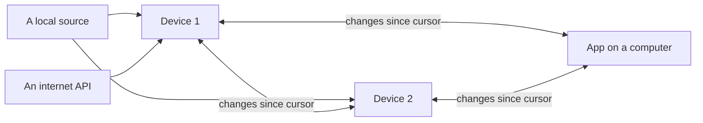

# Bruce's Database: design

bruce-db is a small record store, in Rust, for applications which keep their data both on a computer and on small
devices, such as ESP32 boards with SD cards, and replicate it between them. Every record has a hash key, which names
its DataSet, a sort key, which orders it within the DataSet, and a version, the newest of which wins, so that copies of
a record converge wherever they are kept and in whatever order they arrive. Records are kept in files now, and the
model maps directly onto a single DynamoDB table, for later.

This file is the master copy of the design, begun in November 2026. What is built is the record model, IDs, the file
backend, compaction, the change feed and blobs, see `src/`; what is planned is marked as such. Its first user is
[Bruce's Smart Home](https://github.com/bruceskingle/bruce-smart-home), a desktop app and the ESP32 capture devices
which poll its sources, whose own use of the store is described in that repository's `docs/Store.md`.

## Summary

- **One model for everything an application keeps.** Every **DataSet is a hash key**, and each record in it has a
  **sort key** and a **version**, so that storage, compaction and replication are designed once, not for each kind of
  data. A cache of an API's replies, samples from a sensor and a user's own records all fit it.
- **A formal sort key.** The hash key names a DataSet; the sort key makes a time range a query, orders compaction, lets
  a newer version of a record replace the old one, and, by how it is built, gives each flavour of DataSet: single
  record, list, ordered list or series. With both, a record is one item in a single DynamoDB table.
- **Two layers on disk:** an append-only journal, written in the order records arrive, and compacted files, one line
  per record, ordered by sort key. A crash loses nothing that was written; compaction gives the efficient main files.
- **Replication is pulling a peer's changes since a cursor** and putting them, newest version winning, which is
  idempotent, so that any node can pull from any other, and they converge.
- **Small enough for a device**: std only, no async runtime, records given a line at a time, and an index of the
  journal of about 100 bytes a record, so that an ESP32-S3 with 8 MB of PSRAM runs the whole store.

## The record model

A record is identified by its hash key and its sort key, and the copy with the highest version is the record;
everything else is attributes. Three names:

- A **DataSet** is one hash key, e.g. one thermometer's temperature readings, or one account's bills.
- A **kind** is a family of DataSets with the same rules, e.g. every thermometer's readings, and is the part of their
  hash keys after the site, e.g. `sensor.temperature`. It replaces the tables of an ordinary database: on DynamoDB
  everything is in one table.
- A **flavour** is how a kind's sort key is built, which decides how it is queried and fetched again, see
  [Flavours](#flavours-from-the-sort-key).

| Part | What it is | Example, a thermometer's readings |
| --- | --- | --- |
| Hash key | The DataSet: its site, its kind, which sets its rules, then which one, e.g. a device and a series | `<site>/sensor.temperature/441bf6cc7fcc/indoor` |
| Sort key | Where in that DataSet, ordered: e.g. a UTC time in RFC 3339, so that text order is time order, with a suffix when two share a time | `2026-11-04T07:17:10Z` |
| Version | Which copy of the record is newest: a time, and the origin which wrote it | `2026-11-04T07:20:30Z`, `441bf6cc7fcc` |
| Origin | The node that wrote this version: a device's ID, or an app installation's | `441bf6cc7fcc` |
| Attributes | The record itself, JSON | `{"value": 19.9, "unit": "°C", "open": true}` |

Rules:

1. **Newest version wins.** A put with a lower version than the stored one is ignored; equal times are broken by
   origin, the lowest winning, so that every node ends with the same record whatever order copies arrive in.
2. **Versions are times, from the node's clock**, which must be set before anything is put, e.g. by SNTP on a device.
   A record sampled once, by several nodes, can take the time it is of as its version, so that every node's copy ties,
   and rule 1 keeps exactly one.
3. **A record still changing**, such as a period of steady temperature still open, is put again with a higher version
   each time; nothing is rewritten in place.
4. **Deletes are rare**, and a tombstone, a version with no attributes, so that a peer which still has the record
   learns it is gone.

**Best practice for callers, not a rule of the store:** the store does not know which records are a source's data and
which were worked out from them; the application does. It is best to keep what a source sent, an API's reply or a
device's record, as it sent it, and anything computed from it, e.g. a total or a fitted rate, in DataSets of kinds of
their own, read alongside, if it is worth keeping at all. Then what was given can always be told from what was worked
out, and the worked out can be thrown away and computed again. A cache which mixes them loses which figures the source
gave. What is cheap to work out is best worked out by whoever reads it; what is expensive, e.g. text read from a PDF,
may be kept, with the source record's key and version and the version of the code which made it, so that it is made
again when either changes.

The sort key is what earns its place: "a day of temperature" becomes a range on it, compaction keeps one line for
each, and a record's file is chosen from it, not from when it happened to arrive.

## Sites, and hashed IDs

Every hash key starts with a **site**, the database it belongs to, so that one DynamoDB table, or one peer, can hold
many sites' records, e.g. several households', without their keys meeting. How an application maps its own things to
sites is its choice, e.g. a site for each profile.

### IDs

- **An ID is a hash**: the SHA-256 of the canonical JSON ([RFC 8785](https://www.rfc-editor.org/rfc/rfc8785)) of what
  it is made from, in URL-safe base64 without padding, 43 characters, see `Id::of`. So the schema has one kind of
  identifier, the same everywhere.
- **Rules for what an ID is made from**, which `Id::of` enforces, refusing anything else:
  1. **Every string is normalised to Unicode NFC first**, as RFC 8785 does not, or a name typed two ways gives two
     IDs.
  2. **No arrays.** RFC 8785 keeps an array's order, so the same set in another order would give another ID; an ID's
     input is objects, strings, numbers, booleans and null only.
  3. **Numbers are IEEE doubles**, so an integer beyond 2^53, or an exact decimal, is a string.

  These are only for making IDs: records themselves are stored as they are, arrays and all, and are not
  canonicalised.
- **A thing created is made from its creator's ID, when it was created, and what the creator believed of it then**,
  such as a site, or a person in a family tree with the name and date of birth thought right at the time. Two people
  who create a record of one subject get two IDs. The name and date of birth are attributes as well, corrected there
  as better evidence comes; the ID never changes.
- **The inputs must differ, and a version 1 UUID makes sure of it.** A hash keeps its input's uniqueness rather than
  making any. So what a created ID is made from should include a UUID of version 1
  ([RFC 9562](https://www.rfc-editor.org/rfc/rfc9562)), or its parts: the time, a clock sequence, and a 48-bit node.
  A device's node can be its factory MAC address; an app, which on iOS cannot read a MAC and on macOS sees a private
  one for each network, makes a node at random once for the installation and keeps it, with the multicast bit set, as
  the RFC says for a node that is not a MAC. Hashed, a MAC is not published.
- **A thing found is made from the fields which identify it**, such as `{"account": …, "meter": …}` for a meter, so
  that any node works out the same ID without asking another, and account and meter numbers stay out of file names and
  partition keys.
- **A hash key is `<site>/<kind>/<parts>`**, see `hash_key`. Each part is an ID or a readable name of lowercase
  letters, digits, `.` and `-`, at most 42 characters, so that a name can never be taken for an ID. A kind is always a
  readable name, and a device's own ID may stay readable. The canonical JSON an ID was made from may be kept in its
  DataSet, with a sort key such as `#key`, so that the files can still be read, and redacted.
- **A sort key is never hashed**, as its order is the point of it.
- **In file names, IDs are hex.** FAT, exFAT and macOS keep the case of a name but ignore it in finding one, so two
  base64 IDs can be one name to the file system. A file name is the 64 lowercase hex characters of the same hash, which
  maps back exactly. A kind with very many DataSets, such as a family tree's people, should split them into 256
  directories by a part of their own, as git does, as FAT searches a directory one entry at a time.

### One truth, or each author's

Newest version wins suits records that are copies of one fact, such as two devices' readings of the same meter. It
does not suit, e.g., a family tree in which two people research the same ancestor, find different, overlapping facts,
and may never agree which sources to believe. So each kind says which it is:

- **One truth**: one record, whoever writes it, the newest version winning.
- **Each author's**: each author's records have their own IDs, made from the author's, so a later record from one
  never replaces the other's, and a disagreement stays visible. That two records are one real person is itself a
  record, `same-as`, by the author who believes it, which the other may or may not accept.

### Encryption and Security Contexts

Planned, for a shared DynamoDB table, or records shared between people. Access is controlled by encryption, so that it
holds wherever records are copied.

- **A Security Context** is something a user gives a record, an ID with keys of its own, which can be rolled.
- **Its keys are records too**: each key wrapped for each member allowed to read, with the hash key
  `<site>/sc/<context id>` and the sort key `<key id>/<member id>`, so that a recipient finds a record's key with a
  get, and keys replicate like everything else.
- **An encrypted record** has, in place of its attributes, `{"sc": <context id>, "key": <key id>, "ct": <base64
  ciphertext>}`.
- **Only the attributes are encrypted.** The hash key, sort key, version and origin stay in the clear, as the store
  needs them to put, query, compact and replicate, so a peer, a device or DynamoDB does all of that without being able
  to read a record. They show which DataSet and when, not what, and hashed IDs keep the which opaque.
- **The ciphertext is bound to its record**: an AEAD cipher, such as AES-256-GCM, with the hash key, sort key and
  version as associated data, so that it cannot be moved to another record or passed off as another version.
- **Authors become key pairs**, later: the origin is a public key's fingerprint, and records shared between sites are
  signed with it.

**Unencrypted attributes stay JSON**, not base64: base64 of plain text hides nothing, is a third bigger, and loses what
JSON gives, files people can read, redaction, and DynamoDB maps a filter can look into. An item has `a`, its JSON, or
`enc`, the envelope above, never both, so that the code tells them apart without guessing, and a record is encrypted
later by putting a new version of it.

## Keys for each kind

An application designs each kind's keys: which fields make its hash key after the kind, its sort key and its version,
and which node writes it. For example:

| Kind | Hash key, after the kind | Sort key | Version | Written by |
| --- | --- | --- | --- | --- |
| `sensor.temperature` | device ID / series | period start | period end | the device with the sensor |
| `meter.reading` | hash of account and meter | slot | slot, ties broken by origin | every node that reads the meter |
| `account.bill` | hash of account | issued date, then the bill's ID | fetched | whichever node fetches the account |
| `device.start` | device ID | start time | written once | the device |

When several nodes sample the same source, e.g. a meter on the local network, their copies of a slot differ a little,
taken moments apart, so a slot is one record: its version is the slot, and of equal versions the lowest origin wins,
the same on every node. If that node misses a slot, another's copy fills it. Before the winner's copy arrives a node may
show another's for a while; then it is replaced.

### Flavours, from the sort key

The usual flavours of DataSet are each a way of building the sort key:

| Flavour | Sort key | Fetched again |
| --- | --- | --- |
| Single record, e.g. an account | a constant, e.g. `-` | each fetch puts a new version |
| List | the record's own ID | each record fetched is put; one no longer returned is a tombstone |
| Ordered list, e.g. bills | its order then its ID, `2026-10-01#<bill>` | from the first record not final |
| Fetched series, e.g. an API's half-hourly consumption | the record's time; a month is the range `2026-11` to `2026-12` | what is missing or not final, found by a query of the range |
| Captured series, e.g. sensor samples | the record's time | never; it is sampled once |

- **What a DataSet knows of its own fetching** can be records too, in the same DataSet, with sort keys starting `#`,
  e.g. `#fetched/2026-11`: when that month was fetched and whether it is complete. `#` sorts before every digit, so a
  time range never includes them, and they replicate with the data, so a node which takes over fetching knows what has
  been fetched.
- **Fetching again is a new version**, which replaces the old wherever it has been copied, so data a source revises
  later, e.g. a supplier's re-rated readings, is picked up by fetching it again.
- **An API's reply may be split into records**, each item's JSON as the source sent it, with a `#fetched` record saying
  what was asked for and when. Splitting is allowed; changing a value is not, see the best practice above.
- **The rules stay with the application**: when to fetch again and what counts as final are its own; it reads what is
  kept by a query.
- **An item is at most 400 KB** on DynamoDB, so a series keeps a record per sample or slot, not a month of them, and
  large files go in the blob store, see [Blobs](#blobs).

## Layout on disk

Each node writes every put to a journal, and compaction later folds the journal into each DataSet's files, by sort key,
one line a record. A site is a directory under the store's root, and a DataSet a directory under it, its hash key's
parts as the path, holding one file, or, for a series, a file a day.

```
<root>/<site hex>/
  journal/2026-11-04.jsonl                      every put, in arrival order: {"n","t","from","o","hk","sk","v","a"}
  state.json                                    the store's ID, the last sequence number, the latest compacted
  sensor.temperature/441bf6cc7fcc/indoor/
    2026/11/03.jsonl                            a series: a file a day, by sort key, newest version
  account.bill/<64 hex characters>/records.jsonl  sort keys which are not dates: one file
  blobs/ab/<64 hex characters>                  a blob, by its ID's hex
```

- **The journal is the only file written as records arrive**: appends and, unless the caller says otherwise, see
  `Store::set_sync`, a sync after each, so that a crash loses at most the line being written. Each line has `n`, its
  sequence number in the node's store, one more than the last, which orders the change feed and is the replication
  cursor, and `t`, when it was stored, for people to read. The node is its store's only writer, so the numbers are
  never given twice or out of order, and no clock is involved; the last is kept through compaction, in `state.json`.
- **The journal is indexed in memory**: for each record its newest line's sequence number, version and where the line
  is, not its attributes, which are read from the file when wanted, about 100 bytes a record. A day of 10 second
  samples is about 10 MB of lines but 1 MB of index. Opening a store reads the journal to build it; a put, get or query
  reads only what has been added since, by this process or another.
- **Compaction** folds the journal's days before a date into the DataSets' files: for each file, it merges the file's
  lines with the journal's newest line of each record for it, a line at a time in sort key order, streamed from the
  index, writes the result to a temporary name and replaces the file with it, then deletes the journal's days. An hour
  of steady temperature, put a minute at a time, becomes one line. It stops between files when cancelled, leaving the
  journal to compact again, which gives the same files. This is to change to an hour's journal at a time, see
  [The journal by the hour](#the-journal-by-the-hour).
- **A query** for a range reads the compacted files for it, then the journal, newest version winning.
- **Replacing a file on FAT**: a rename onto an existing file replaces it on macOS and Linux, but fails under ESP-IDF
  with "File exists". So the old file is moved aside, to `.old`, the new one renamed into place, and the old deleted; a
  crash between leaves only the `.old`, which is put back when the file is next read, and the journal, only deleted
  once compaction has finished, gives the same file again.
- **FAT32 or exFAT is fine**, so that a device's card can still be read in a computer; the SD card's controller does
  the wear levelling, and the journal's sequential appends suit it.

### Blobs

Files, e.g. a PDF, go in a blob store beside the records, named by their ID, the SHA-256 of their contents, see
`Store::put_blob`; a record refers to its blob by its ID. Files on disk now, and an object store beside DynamoDB
later. A node with little space, e.g. a device, may choose not to keep or replicate large blobs.

### DynamoDB

Planned. DynamoDB maps directly onto a single table, `hk` its partition key and `sk` its sort key, with the site as the
hash key's first part.

| Attribute | Type | Example |
| --- | --- | --- |
| `hk` (partition key) | String | `<site>/sensor.temperature/441bf6cc7fcc/indoor` |
| `sk` (sort key) | String | `2026-11-04T07:17:10Z` |
| `v` | String | the time, then the origin's ID inverted |
| `o` | String | `441bf6cc7fcc` |
| `a` or `enc` | Map | `{value: 19.9, unit: "°C", open: true}` |
| `w` | String | the site and the writer, the node which put it, the change feed's partition key |
| `n` | Number | the writer's sequence number of the put, the change feed's sort key |
| `t` | String | when it was stored, for people to read |
| `deleted`, `ttl` | Bool, Number | only on tombstones, so that DynamoDB's TTL clears them in time |

- **The version is one string**, the time then the origin's ID with each byte inverted, so that comparing strings is
  rule 1, the lowest origin sorting highest, and a put is conditional on it: `attribute_not_exists(hk) OR v < :v`. A
  refused condition is `Put::Older`. Unlike the journal, DynamoDB only ever holds the winning version.
- **A DataSet is one partition**, and a range a `Query` with `sk BETWEEN`, which includes both ends, so the end is
  dropped by the client; `begins_with(sk, "2026-11")` gets a month.
- **The change feed is a global secondary index** whose partition key is the site and the writer, `w`, the node which
  put the item into the table, and whose sort key is that writer's sequence number, `n`, from its own store. Many nodes
  write to the one table, so no one sequence orders its changes, and a time would not do: clocks differ, and a write
  can land just after a reader has read past its time. So a reader's cursor is a sequence number for each writer,
  `{"app-3f…": 1042, "441bf6cc7fcc": 88}`, each read from its own partition, and nothing is missed or read again.
- **Not DynamoDB Streams for the feed**, as they keep only 24 hours, too short for a node away for longer, and the feed
  must be the same pull, from a cursor, as between files, so that every peer replicates one way.
- **Pushing changes as they happen, later**: Streams can feed a Lambda which publishes to SNS, SQS or WebSockets, so
  that a node learns of a change at once rather than at its next pull. That is a notification, saying a writer has put
  changes up to a sequence number, not the data's only path: a subscriber still pulls from its cursor, so one which
  missed notifications catches up the same way.
- **Each node keeps a file store of its own, and DynamoDB is a peer**, replicated with as any node is, rather than
  replacing a node's store, so that every node works offline. Which backends are built is chosen by Cargo features,
  `dynamodb` for computers only; which one a store uses is its location, e.g. `file:///…` or
  `dynamodb://<table>?region=…`, given to `Store::open`, so that no code outside the crate names a backend.

## Operations and the backend

A few operations cover every store, behind one trait, `Backend`, so that the files now and DynamoDB later are two
implementations of it. `Store` wraps it for a site, see `src/lib.rs`.

```rust
pub trait Backend: Send + Sync {
    fn store_id(&self) -> String;
    /// Stores item unless a copy as new is stored; from is the peer it was pulled from.
    fn put(&self, item: &Item, from: Option<&str>) -> Result<Put>;          // Put::Stored | Put::Older
    fn get(&self, hk: &str, sk: &str) -> Result<Option<Item>>;
    /// The newest version of each record of the DataSet hk with a sort key in range, in order, one at a time.
    fn query(&self, hk: &str, range: Range<&str>, visit: &mut dyn FnMut(Item) -> Result<Flow>) -> Result<()>;
    /// Every change stored after since, in the order stored, up to limit, but those from or originated by for_peer.
    fn changes(&self, since: Cursor, limit: usize, for_peer: Option<&str>,
               visit: &mut dyn FnMut(Change) -> Result<()>) -> Result<Cursor>;
    fn data_sets(&self, prefix: &str) -> Result<Vec<String>>;
    fn compact(&self, before: Date, progress: &mut dyn Progress) -> Result<()>;
    fn put_blob(&self, bytes: &[u8]) -> Result<Id>;
    fn get_blob(&self, id: &Id) -> Result<Option<Vec<u8>>>;
    fn set_sync(&self, sync_each_put: bool);
    fn sync(&self) -> Result<()>;
}
```

- **Visitors, not vectors**: results are given a record at a time, so that a device never holds more than a line, and
  an application can stream into its pages. `query_all` and `all` collect them, for small DataSets.
- **Locking**: a store takes a file lock on its journal while it appends or compacts, so that two processes on a
  computer can share a site; a device has one writer, and no lock.
- **Std only, no async runtime**, so that it builds for ESP-IDF as well as macOS and Linux; an async application calls
  it from a blocking task or a thread of its own.
- **The policies stay with the callers**: when to poll, when to fetch again, what counts as final, and when to compact.

## Using the crate

- **Opening**: `Store::open("file:///<root>", &site)` makes the site's directory if it is not there, gives the store
  its ID, and reads the journal into the index, which takes time in proportion to the journal, so a store is best
  opened once and shared, e.g. in an `Arc`, rather than opened for each use.
- **Compacting is the caller's to schedule.** `Store::compact(before)` folds the journal's days before `before`. Leaving
  a day, e.g. compacting the days before yesterday, keeps late records in the journal a while, though merging is newest
  version wins, so a late record is never lost either way. It holds the store while it runs, so puts, gets and queries
  wait for it: an application should run it on a thread of its own, away from its start, e.g. a minute after opening
  and then hourly, which costs only a listing of the journal when there is nothing to fold. Nodes which share a
  workload should not all compact at once. `compact_with_progress` reports how far it is and can be cancelled, for a
  large journal, e.g. after a bulk load.
- **Bulk loads**: `set_sync(false)` skips the sync after each put, and `sync()` at the end makes it durable.
- **Logging** is with the `log` crate, target `bruce_db`: warnings, e.g. a journal line which cannot be read, and at
  info, how long opening and compacting took, and any refresh of the index which took over a second. An application
  which wants them in its own log installs a `log` logger.
- **Errors** are `anyhow` errors, with their chain of causes.

### On a device

- **A board needs PSRAM** for the index, e.g. an ESP32-S3 with 8 MB. ESP-IDF gives an allocation below
  `CONFIG_SPIRAM_MALLOC_ALWAYSINTERNAL`, 16 KB by default, from internal RAM first, so the index's many small
  allocations would use the internal RAM that TLS and DMA need: set it to 0, keep
  `CONFIG_SPIRAM_MALLOC_RESERVE_INTERNAL` for DMA, and measure.
- **A board without PSRAM** can still append records in the journal's format and give them as a change feed, a line at
  a time, for a peer to pull, without the index, compaction or queries; the crate does not do this yet.
- **Long file names**: ESP-IDF needs them on, `CONFIG_FATFS_LFN_HEAP`, and `CONFIG_FATFS_MAX_LFN` of 255, which a hash
  key's parts, 64 hex characters for an ID, fit within; and exFAT on for cards formatted that way.
- **Few open files**: a FAT mount allows only as many files open at once as its `max_files`, e.g. 4, so the crate
  keeps as few open as it can, one for the journal's lines while compacting, and a mount should allow at least 4.
- **The clock** must be set, e.g. by SNTP, before anything is put, as versions and the journal's days come from it.
- **Log with the `log` macros**, never `println!` or `eprintln!`, which panic on a device with no computer reading its
  USB port.
- **A crash while compacting** may happen again at once on restart, so a device should keep a guard, e.g. a file
  written before compacting and removed after, and not compact again in a build which crashed doing it, until the
  crate's own guard, see [The journal by the hour](#the-journal-by-the-hour).

## Replication

Every node pulls each peer's changes since the cursor it last got and puts them into its own store; because the newest
version wins, the order and repeats do not matter, and the nodes converge.



- **The feed** is `changes`, which an application serves over its own transport, e.g. a device's HTTP API, a page at a
  time, e.g. `GET /api/store/changes?since=<sequence>&limit=500`, with each change as a journal line,
  `Change::to_json`. A node's store has one writer, itself, so the cursor a peer keeps for it is one number, the
  sequence number of the last change it got.
- **A store has an ID of its own**, `store_id`, made when it is first made and kept in `state.json`, which the feed
  should give with each page, so that when a store is replaced, e.g. a device's card is wiped and its sequence numbers
  start again, a peer starts again from 0 rather than waiting for them to pass its old cursor.
- **Replicated records are passed on**, as a node's own are, so that a record crosses nodes which do not pull from
  each other directly, A to B to C.
- **They cannot loop**: a put that changes nothing, a version a node already has, is not journalled, so a record which
  comes back to a node stops there.
- **Nor go back where they came from**: each journal line has `from`, the peer it was pulled from, beside `o`, its
  origin, and the feed for a peer leaves out the lines from it or originated by it, as routing protocols' split
  horizon does, so a record does not even make the one wasted trip back.
- **A node serving changes keeps no state about its clients.** Each request carries all that is needed, its cursor; a
  node never remembers its peers' cursors, nor waits for them, e.g. to compact only what every peer has read, which
  would work for a handful of nodes but ties them together.
- **Who fetches what is the application's choice**, e.g. every node samples a local source, so that any one keeps going
  alone, while one node owns each internet source, to spare its rate limits, and the others get its records by
  replication.

## The journal by the hour

Planned, agreed on 13 November 2026, after devices running the store had run out of memory compacting several days of
journal at once, and an application had been slow to start. The size of the journal was behind every symptom: opening
a store reads and parses all of it; compaction listed every record of the days it folded on top of the index, since
fixed to stream; and the change feed walks the whole index for each page, about 9 seconds a page of 500 on an
ESP32-S3. So the journal is to be kept small, and nothing is to be done in one big piece.

The principle, beside the stateless server above: **nothing reads in proportion to the size of the store**, except a
full copy, which reads it once, a page at a time. A query reads its DataSet's files for its range, opening reads the
journal not yet compacted, and catching up reads what is new.

- **A journal file an hour**, e.g. `journal/2026-11-13T06.jsonl`, rather than a day, as a journal file can only be
  deleted whole, so its length sets how small a step compaction can take. The daily files of stores made before are
  read as long segments until they are compacted.
- **Compaction a little and often**: an hour is compacted soon after it ends, a DataSet's file at a time, each a short
  step, so that puts wait for at most one, and a crash loses at most one. No grace period is needed for correctness, as
  merging is newest version wins: a late record lands in a later hour and is merged into its file when that hour is.
  There is no special time of night, and no two nodes need to avoid each other's.
- **Appending, not rewriting**: a time series' records nearly always sort after everything already in its file, so a
  step mostly appends to the end of the day's file, and rewrites it, merged, only when a record falls inside it, which
  keeps the writes to an SD card down.
- **A crash guard**: a node notes the step it is taking, and one which starts to find a step unfinished skips that
  file and reports it, rather than crash on it again.
- **Only the hours not yet compacted are in the index**, so opening reads an hour or two, parsing only each line's
  head, `n`, `o`, `hk`, `sk` and `v`, not its attributes, which on a Mac takes a third of the time of parsing the whole
  line.
- **Compacted hours are kept**, read only and out of the index, for a retention period, a few days by default, then
  deleted, so that a peer catching up reads them, in sequence order, rather than the compacted files, which are in
  sort key order and can only be searched for a sequence number by reading all of them. The retention must comfortably
  outlast a full copy by the slowest peer expected.

The change feed then has two paths, and an answer for the gap between them, never a scan of the whole store:

- **Catching up**, a `since` within the journal kept: the node finds the hour file holding `since`, by its first line,
  and reads forward. It may give a version since superseded, which is harmless, as the newest version wins.
- **Too far behind**, a `since` older than the oldest hour kept: the answer says so, and the peer makes a full copy.
- **A full copy** walks the compacted files in their own order, DataSet by DataSet, file by file, in sort key order,
  having first taken the node's latest sequence number as its watermark. Its cursor carries the watermark and where it
  has got to, a DataSet, a file and the last sort key given, so each page reads only that page, and a file rewritten
  under it is picked up at the right place. When it is done, the peer catches up from the watermark, which brings
  anything changed meanwhile, including a record moved into a file the walk had passed. Each page first checks that
  the watermark is still within the journal kept, and if it is not, answers that the copy has expired and must start
  again: the peer keeps what it has, as putting it again changes nothing, but a change to a file already passed could
  otherwise be lost. The cursor becomes a token the peer passes back unread, rather than a number.

### Volumes

Later, building on the above: **a store is a set of volumes**, by default a year each, by the date its records' sort
keys start with, and records whose sort keys have no date, e.g. accounts and settings, are a volume of their own.

- **Past volumes rarely change**, but do: a source revises old data, a December bill comes in January, and an offline
  device brings old readings. Every change still goes through the journal, so catching up sees it.
- **Each volume keeps its highest sequence number**, updated by compaction, which is cheap to keep from the start.
- **A full copy goes a volume at a time**, the undated first, then the current, then back in time, and copies again
  any volume whose highest sequence number moved while it was copied, only that one, so that a copy outlasting the
  retention starts again only for a volume, nearly always the current one.
- **Two stores can be compared** a volume at a time, by those numbers or a digest, without reading them.
- **A device can drop old volumes** once a larger node holds them, keeping, say, the current and the one before, which
  bounds its card and its store.

## Versions of formats

What a store keeps changes over time in two ways, versioned separately, so that neither needs the whole of a store
rewritten at once, which on a shared DynamoDB table could not be done, and on a device would leave it without its data
while it was:

- **The store's own layout**, how this crate keeps records, e.g. the journal's lines and the files' names, is to have a
  version in a file at the root of each site's directory, `format.json`, `{"format": 2}`, from the hourly journal on; a
  site without one is format 1. A node opening a site of an older format converts it before using it, or reads it as
  it is where it can, e.g. a format 1 store's daily journal files until they are compacted away; one of a newer format
  is refused rather than misread. On DynamoDB the format is the table's, as a node only reads and writes items through
  this crate.
- **A kind's records**, what an application puts in them, have a version per kind: a kind whose records change format
  becomes a new kind, its version in its name, e.g. `meter.reading.v2` beside `meter.reading`, written alongside the
  old, which is never rewritten in place. Readers move to the new kind once it is complete, by conversion, which may be
  done lazily, as records are read, and the old kind is deleted later. A record of the old kind and one of the new are
  never confused, as their hash keys differ, and the same works on files and on DynamoDB, where a table holds both
  until the old is deleted.
- **Old data is left as it was until the new is complete**, so that a conversion which is cancelled, or fails, or is
  cut short by a crash, can be done again from the start: what it had put is put again, which changes nothing, and
  only once it is complete is the old marked as replaced.

## Space used

Planned. As more is collected, a device's card fills, so a node should say how much space each kind of data takes, as
a tree which follows the hash keys: the site, then each kind, then each part of its hash keys, then the days of a
series, each level the total of those under it, so that the breakdown can be seen at any of them, and what to clear can
be chosen, e.g. a kind's oldest days.

The parts of a hash key are already the directories, so the tree is the directory tree, and the space is its files'
sizes, by scanning or by keeping running totals:

- **Scanning** is simple and never wrong, but on a card with years of a file a day it means reading the size of
  thousands of files, which on FAT over SD on an ESP32 may take seconds to minutes, so it could not be asked for often.
- **Running totals** are cheap to read but must be kept right through every append, compaction and deletion, and
  through a crash in between.
- **Between the two**, which may be enough: compaction knows the size of each file it writes, so it records each
  DataSet's total, e.g. as a `#space` record in the DataSet, which replicates with it, and the journal not yet
  compacted is added by its own size, a few files at most. Then a breakdown is a read of a record per DataSet, summed
  up the tree, and a full scan is only needed to check it.

## The crate

`bruce-db`, in its own repository, published to crates.io, licensed MIT OR Apache-2.0. Its dependencies: `serde_json`,
`serde_jcs` for RFC 8785 (MIT OR Apache-2.0; `serde_json_canonicalizer` is MIT only), `unicode-normalization` for NFC,
`sha2`, `base64`, `time`, `log`, `anyhow`, and `bruce-util-progress` for progress and cancellation; a `dynamodb`
feature later, for computers only.

### Order of work

1. Done, 0.1.0, 10 November 2026: the record model, IDs, the file backend with its lean index, compaction, the change
   feed with its split horizon, the store's ID, blobs, and `log`, with tests on a Mac, and built for
   `xtensa-esp32s3-espidf`.
2. Done, 13 November 2026, for 0.2.0: compaction streams each file's records from the index, a date's sort keys being
   a run of it, rather than listing them all first, which ran a device out of memory; files on FAT are replaced by
   moving the old aside; and reading lines keeps its buffer.
3. Timings of opening, refreshing and compacting, in the log, built 13 November 2026. A Mac opened a journal of two
   days, 86 MB of 108,315 lines, in 0.42 s, but an ESP32-S3 opened two days, 15 MB of 12,734 lines from its SD card,
   in 47 s, about 3.7 ms a line, which is most of its start. Compaction's figures are still to be read.
4. Parsing only the head of each line when opening.
5. The hourly journal, compaction a step at a time, and the crash guard, with `format.json` going to 2.
6. Keeping compacted hours, and catching up from them, with the answer for being too far behind.
7. The full copy, with its watermark.
8. Volumes.
9. Later: Security Contexts, DynamoDB, the space used.

## Open questions

- [x] Compaction's grace period for late records: none needed, as merging is newest version wins, and an hour's
  journal is kept after it is compacted (13 November 2026).
- [ ] How long compacted journal hours are kept: a few days? Longer on a computer?
- [ ] How nodes trust each other's feeds: certificates or keys exchanged when a node joins a site?
- [ ] The space used: scanned, running totals, or totals kept by compaction? And what a node does as its card fills,
  e.g. drop a kind's oldest days which have been replicated elsewhere?
- [ ] Priority among origins for a tied version, set by the application, rather than the lowest origin?
