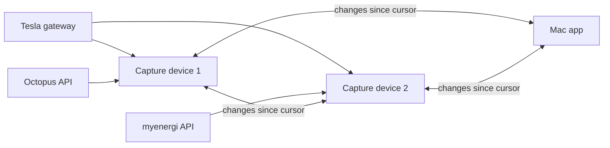

# Bruce's Database: design

A shared record store for Marco Sparko (the app and its capture devices), and later other applications, such as a
family tree. This began as a design discussion in November 2026; this file is now the master copy. Nothing here is
built yet.

## Summary

Put everything the app and the capture devices keep, the API caches included, into one store, a crate both use, in
which every **DataSet is a hash key**, and each record in it has a **sort key** and a **version**, so that storage,
compaction and replication are designed once rather than per module.

- **A formal sort key.** The hash key names a DataSet; the sort key makes a time range a query, orders compaction,
  lets a newer version of a record replace the old one, and, by how it is built, gives each flavour of DataSet:
  single record, list, ordered list or series. With both, a record is one item in a single DynamoDB table.
- **Two layers on disk:** an append-only journal, written in the order records arrive, and compacted files, one line
  per record, ordered by sort key. A crash loses nothing that was written; compaction gives the efficient main files.
- **Replication is pulling a peer's journal since a cursor** and merging, newest version wins, which is idempotent, so
  devices and the app can all pull from each other.
- **Every DataSet moves onto the store**, the API caches as well as the captured records, so that the whole profile
  replicates. A DataSet keeps its rules for when to fetch again; the store keeps its records.

It starts with the temperature log, the newest and smallest of Marco Sparko's stores, once the new SD cards are in.

## Where Marco Sparko is

Only the Octopus API caches use DataSet; every store added since the capture devices has its own code and its own
layout. Paths are in the marco-sparko repository.

| Data | Where | Code | On disk | DataSet? |
| --- | --- | --- | --- | --- |
| Octopus API data: bills, measurements, telemetry, sessions, rates | App | `src/data_set/*` | One JSON file a set, locked, refresh and final rules | Yes |
| Tariff history | App | `src/octopus/meter_agreement.rs` | `<account>#TariffHistory`, JSON lines appended | No, hash-key name only |
| Tesla snapshots | App | `src/tesla/snapshot.rs` | JSON lines a day, own dedupe and "latest" | No |
| myenergi status | App | `src/myenergi/fetch.rs` | A file a poll, `#status-HHMMSS` | No |
| myenergi minute records | App | `src/myenergi/fetch.rs` | A day file, read, merged, rewritten | No |
| Octopus dispatches | App | `src/octopus/flex_poll.rs` | Own save-if-new | No |
| Temperature and humidity | App | `src/climate.rs` | `<profile>-climate/<device>/<series>/<date>.json` | No, its own layout |
| Poll log | App | `src/polling.rs` | `<profile>-polling/<date>.jsonl` | No |
| Captured records | Device | `capture/src/day_files.rs` | `/sd/capture/<feature>/<date>.jsonl`, appended, read by `since` | No |
| Start log | Device | `sparko-esp-idf/src/starts.rs` | NVS, the last 30 | No |

They drifted because DataSet was built as a cache of data an API can give again, and these are not: they are samples
taken once, from several devices, arriving late or out of order, some of them newer versions of a record already
kept, such as the open temperature period. The store has to serve both. The cost of drifting shows already: the 1 Nov
unpadded-day bug was in Tesla's copy of the day-path code only, and "latest" is found by file modification time,
which is wrong once devices write old records after new ones.

## The record model

A record is identified by its hash key and its sort key, and the one with the highest version is the record;
everything else is attributes. Three names:

- A **DataSet** is one hash key, as a DataSet is one file in Marco Sparko now, e.g. one device's temperature.
- A **kind** is a family of DataSets with the same rules, e.g. every device's temperature, and is the part of their
  hash keys after the site, `climate.period`. It replaces the tables of an ordinary database: on DynamoDB everything
  is in one table.
- A **flavour** is how a kind's sort key is built and what it fetches again, the Rust type, e.g. `MonthlyDataSet`,
  see [Flavours](#flavours-from-the-sort-key).

| Part | What it is | Example (the temperature log) |
| --- | --- | --- |
| Hash key | The DataSet: its site, its kind, which sets its rules, then which one, e.g. a device and a series | `<site>/climate.period/441bf6cc7fcc/temperature` |
| Sort key | Where in that DataSet, ordered: a UTC time in RFC 3339, so text order is time order, with a suffix when two share a time | `2026-11-04T07:17:10Z` |
| Version | Which copy of the record is newest | the period's end, `2026-11-04T07:20:30Z` |
| Origin | The node that wrote this version: a device's ID, or the app's | `441bf6cc7fcc` |
| Attributes | The record itself, JSON | `{"value": 19.9, "unit": "°C", "open": true}` |

Rules:

1. **Newest version wins.** A put with a lower version than the stored one is ignored; equal versions are broken by
   origin, the lowest device ID winning, so every node ends with the same record whatever order copies arrive in.
2. **Versions are times, from the node's clock**, which SNTP sets on the devices. A record sampled once, such as a
   Tesla snapshot, has its slot as its version, so every device's copy of a slot ties, and rule 1 keeps exactly one.
3. **A record still changing**, such as the open period, is put again with a higher version each time; nothing is
   rewritten in place.
4. **Deletes are rare**, and a tombstone, a version with no attributes, so that a peer which still has the record
   learns it is gone.

**Best practice for callers, not a rule of the store:** the store does not know which records are a source's data and
which were worked out; the app does. It is best to keep what a source sent, an API's reply or a device's record, as it
sent it, and anything computed from it, e.g. units from a cost and a rate, a total, a fitted rate, in DataSets of
their own kinds, read alongside, if it is worth keeping at all. Then what was given can always be told from what was
worked out, and the worked out can be thrown away and computed again. Marco Sparko's Octopus meter readings cache
mixed them, and lost which figures Octopus gave.

The sort key is what earns its place: "a day of temperature" becomes a range on it, compaction keeps one line for
each, and a record's file is chosen from it, not from when it happened to arrive.

## Sites, and hashed IDs

Every hash key starts with a **site**, the database it belongs to, so that one DynamoDB table, or one peer, can hold
many households' records without their keys meeting.

### IDs

- **An ID is a hash**: the SHA-256 of the canonical JSON ([RFC 8785](https://www.rfc-editor.org/rfc/rfc8785)) of what
  it is made from, in URL-safe base64 without padding, 43 characters. So the schema has one kind of identifier, the
  same everywhere.
- **Rules for what an ID is made from**, which the code that makes IDs enforces, refusing anything else:
  1. **Every string is normalised to Unicode NFC first**, as RFC 8785 does not, or a name typed two ways gives two
     IDs.
  2. **No arrays.** RFC 8785 keeps an array's order, so the same set in another order would give another ID; an ID's
     input is objects, strings, numbers, booleans and null only. Sorting arrays as sets, dropping repeats and nulls,
     would also work, but nothing here needs it.
  3. **Numbers are IEEE doubles**, so an integer beyond 2^53, or an exact decimal, is a string.

  These are only for making IDs: records themselves are stored as they are, arrays and all, and are not
  canonicalised.
- **A thing created is made from its creator's ID, when it was created, and what the creator believed of it then**,
  such as a site, a Security Context, or a person in a family tree with the name and date of birth thought right at
  the time. Two people who create a record of one subject get two IDs, and a user, who sees the whole database, does
  not create two. The name and date of birth are attributes as well, corrected there as better evidence comes; the ID
  never changes.
- **The inputs must differ, and a version 1 UUID makes sure of it.** A hash keeps its input's uniqueness rather than
  making any: different inputs give different IDs, the same input the same ID. So what a created ID is made from
  includes a UUID of version 1 ([RFC 9562](https://www.rfc-editor.org/rfc/rfc9562)): the time in 100 ns steps, a
  clock sequence, which changes if the clock goes back, and a 48-bit node, the computer's network address. A capture
  device's node is its ESP32's factory MAC. iOS hides MACs from apps, and macOS gives Wi-Fi a private address for each
  network, so an app's node is one made once for the installation and kept in its settings, with the multicast bit
  set, as the RFC says for a node that is not a MAC. Hashed, the MAC is not published. A user's ID is made the same
  way, and later from their public key.
- **A thing found is made from the fields which identify it**, such as `{"account": …, "meter": …}` for a meter, or a
  census page's image, so that any node, or two researchers, work out the same ID without asking each other, and
  account and meter numbers stay out of file names and partition keys.
- **A hash key is `<site>/<kind>/<id>`**. A kind stays a readable name, and a device's own ID may stay readable. The
  canonical JSON an ID was made from is kept in its DataSet, with the sort key `#key`, so that the files can still be
  read and redacted.
- **A sort key is never hashed**, as its order is the point of it.
- **In file names, IDs are hex.** FAT, exFAT and macOS keep the case of a name but ignore it in finding one, so two
  base64 IDs, or worse their first few characters as a directory, can be one name to the file system. A file name is
  the 64 lowercase hex characters of the same hash, which maps back exactly; readable parts of a hash key are
  lowercase letters, digits, `.` and `-` only. A kind with many DataSets, such as a family tree's people, splits them
  into 256 directories by their first two hex characters, as git does, as FAT searches a directory one entry at a
  time.

### One truth, or each author's

Newest version wins suits records that are copies of one fact, such as the gateway's reading of a slot. It does not
suit a family tree, a second application for the store, in which two people research the same ancestor, find
different, overlapping facts, and may never agree which sources to believe. So each kind says which it is:

- **One truth**: one record, whoever writes it, the newest version winning, as for every Marco Sparko kind.
- **Each author's**: each author's records have their own IDs, made from the author's, so a later record from one
  never replaces the other's, and a disagreement stays visible. That two records are one real person is itself a
  record, `same-as`, by the author who believes it, which the other may or may not accept.

### Encryption and Security Contexts

Marco Sparko needs none now; a shared DynamoDB table, or a family tree shared between researchers, would. Access is
controlled by encryption, so that it holds wherever records are copied.

- **A Security Context** is something a user gives a record, an ID with keys of its own, which can be rolled.
- **Its keys are records too**: each key wrapped for each member allowed to read, with the hash key
  `<site>/sc/<context id>` and the sort key `<key id>/<member id>`, so that a recipient finds a record's key with a
  get, and keys replicate like everything else.
- **An encrypted record** has, in place of its attributes, `{"sc": <context id>, "key": <key id>, "ct": <base64
  ciphertext>}`.
- **Only the attributes are encrypted.** The hash key, sort key, version and origin stay in the clear, as the store
  needs them to put, query, compact and replicate, so a peer, a device or DynamoDB does all of that without being able
  to read a record. They show which DataSet and when, not what, and hashed IDs keep the which opaque.
- **The ciphertext is bound to its record**: an AEAD cipher, such as AES-256-GCM, with the hash key, sort key and
  version as associated data, so that it cannot be moved to another record or passed off as another version.
- **Authors become key pairs**, later: the origin is a public key's fingerprint, and records shared between sites are
  signed with it.

**Unencrypted attributes stay JSON**, not base64: base64 of plain text hides nothing, is a third bigger, and loses what
JSON gives, files you can read, Marco Sparko's redaction, and DynamoDB maps a filter can look into. An item has `a`,
its JSON, or `enc`, the envelope above, never both, so that the code tells them apart without guessing, and a record
is encrypted later by putting a new version of it.

## Keys for each kind

Every Marco Sparko store, the API caches included, fits the model; what differs is which fields make the keys and the
version. A DataSet's hash key is its site, its kind, then the rest, e.g. `<site>/tesla.snapshot/<DIN>`.

| Kind | Hash key, after the kind | Sort key | Version | Written by |
| --- | --- | --- | --- | --- |
| `tesla.snapshot` | gateway DIN | slot | slot, ties by origin | every node that polls the gateway |
| `myenergi.status` | hub serial | slot | received | the owner of myenergi, see [Replication](#replication) |
| `myenergi.minutes` | device serial | minute | fetched | the owner of myenergi |
| `octopus.dispatch` | account / charging device | dispatch start | received | the owner of Octopus |
| `octopus.tariff` | account / import, export or gas | agreement valid from | seen | the owner of Octopus |
| `climate.period` | device ID / temperature or humidity | period start | period end | the device with the sensor |
| `device.start` | device ID | start time | written once | the device |
| `app.poll` | profile / module | time | written once | the app |

Every device polls the Tesla gateway, and their snapshots of a slot differ a little, taken moments apart, so a slot
is one record: its version is the slot, and of equal versions the lowest device ID wins, the same on every node. If
that device misses a slot, another's reading fills it, which is sound, as the totals are the gateway's own. Before the
winner's copy arrives a node may show another device's for a while; then it is replaced.

### Flavours, from the sort key

Marco Sparko's DataSet flavours are each a way of building the sort key, with the fetching rules they have now:

| Flavour | Now | Sort key | Fetched again |
| --- | --- | --- | --- |
| Single record | `SingleRecordDataSet`, e.g. the account | a constant, `-` | each fetch puts a new version |
| List | `ListDataSet`, `MultiQueryDataSet` | the record's own ID | each record fetched is put; one no longer returned is a tombstone |
| Ordered list | `OrderedListDataSet`, the bills | its order then its ID, `2026-10-01#<bill>` | from the first record not final, as now; an open bill the server replaced is a tombstone |
| Monthly series | `MonthlyDataSet`, `MonthlyFixedSlotDataSet`, e.g. consumption | the record's time; a month is the range `2026-11` to `2026-12` | as now, finding what is missing or not final by a query of the month |
| Captured series | Tesla, myenergi, dispatches, climate | the record's time | never; it is sampled once |

- **What a DataSet knows of its own fetching** is records too, in the same DataSet, with sort keys starting `#`, e.g.
  `#fetched/2026-11`: when that month was fetched and whether it is complete. `#` sorts before every digit, so a time
  range never includes them, and they replicate with the data, so a device which takes over polling knows what has
  been fetched.
- **Fetching again is a new version**, which replaces the old wherever it has been copied. That also makes the
  re-rated "final" slots Octopus revises weeks later easy to pick up: fetch them again now and then.
- **The lock a DataSet holds while it fetches** stays, as a lock on its hash key, so two app processes do not fetch
  the same month at once; between nodes, only a source's owner fetches.

## Layout on disk

Each node writes every put to a journal of the day it arrived, and compaction later folds each finished journal into
each DataSet's files, by sort key, one line a record. A site is a root directory, and a DataSet a directory under it,
its hash key's parts as the path, holding one file, as a DataSet is now, or, for a series, a file a day.

```
<root>/<site>/
  journal/2026-11-04.jsonl                        every put, in arrival order: {"t","from","o","hk","sk","v","a"}
  climate.period/441bf6cc7fcc/temperature/
    2026/11/03.jsonl                              a series: a file a day, by sort key, newest version
  octopus.account/<64 hex characters>/records.jsonl   a single record or a list: one file
```

- **The journal is the only file written while a day is going on**: appends and a sync, as the capture devices do
  now, so a crash loses at most the line being written. Its `t`, when the node stored the put, is also the
  replication cursor.
- **Compaction** runs once a journal day has ended and a grace period, say a day, has passed for late arrivals: it
  reads the journal, keeps the newest version of each record, merges into the existing files, writes each to a
  temporary name and renames it over, then deletes the journal. An hour of steady temperature, about 60 journal lines
  today, becomes one.
- **A query** for a range reads the compacted files for it, then the journal days not yet compacted, newest version
  winning.
- **Each part of a hash key is a directory**: a readable part as it is, an ID in hex, see [IDs](#ids).
- **FAT32 or exFAT stays**, so a card can still be read in a Mac or PC; the SD card's own controller does the wear
  levelling, and these writes are sequential appends it handles well. ESP-IDF needs long file names on, as now, and
  exFAT on for cards formatted that way.
- **On a device without PSRAM**, such as the CYD, compaction needs a day's keys in RAM, about 350 KB for a day of 10
  second Tesla records, so it leaves compaction to a peer or the app, or does it a partition at a time.

### DynamoDB

DynamoDB maps directly onto a single table, `hk` its partition key and `sk` its sort key, with the site as the hash
key's first part.

| Attribute | Type | Example |
| --- | --- | --- |
| `hk` (partition key) | String | `<site>/climate.period/441bf6cc7fcc/temperature` |
| `sk` (sort key) | String | `2026-11-04T07:17:10Z` |
| `v` | String | the time, then the origin's ID inverted |
| `o` | String | `441bf6cc7fcc` |
| `a` or `enc` | Map | `{value: 19.9, unit: "°C", open: true}` |
| `t` | String | when it was stored, for the change feed |
| `deleted`, `ttl` | Bool, Number | only on tombstones, so that DynamoDB's TTL clears them in time |

- **The version is one string**, the time then the origin's ID with each byte inverted, so that comparing strings is
  rule 1, the lowest ID sorting highest, and a put is conditional on it: `attribute_not_exists(hk) OR v < :v`. A
  refused condition is `Put::Older`. Unlike the journal, DynamoDB only ever holds the winning version.
- **A DataSet is one partition**, and a range a `Query` with `sk BETWEEN`, which includes both ends, so the end is
  dropped by the client; `begins_with(sk, "2026-11")` gets a month.
- **The change feed is a global secondary index** on the time stored, not DynamoDB Streams, which keep only 24 hours,
  too short for a device away for longer. It is read from a few minutes before the cursor, as the writers' clocks
  differ and a repeat does no harm.
- **An item is at most 400 KB**, which is why each slot is a record, not a month of them.

## Operations and the backend

Five operations cover every store, behind one trait, so the files now and DynamoDB later are two implementations of
it.

```rust
pub trait Backend {
    /// Stores item unless a newer version is stored, saying which happened.
    fn put(&self, item: &Item) -> Result<Put>;              // Put::Stored | Put::Older
    fn get(&self, hk: &str, sk: &str) -> Result<Option<Item>>;
    /// The newest version of each record of the DataSet hk with a sort key in range, in order, one at a time.
    fn query(&self, hk: &str, range: Range<&str>, visit: &mut dyn FnMut(Item) -> Result<Flow>) -> Result<()>;
    /// Every put stored after cursor, in the order stored, up to limit: the replication feed.
    fn changes(&self, since: Cursor, limit: usize, visit: &mut dyn FnMut(Item) -> Result<()>) -> Result<Cursor>;
    fn compact(&self, before: Date) -> Result<()>;
}
```

- **Visitors, not vectors**: results are given a record at a time, as the capture devices' `day_files.rs` does now,
  so the CYD never holds more than a line, and the app can stream into its pages.
- **Locking**: the app takes a file lock on the journal while it appends, as DataSet does, so two app processes can
  share a site; a device has one writer.
- **Std only, no async runtime**, so it builds for ESP-IDF as well as macOS; the app calls it from its own tasks.
- **The policies stay with the callers**: when to poll, when to fetch again, what counts as final.

## Replication

Every node, device or app, pulls each peer's changes since the cursor it last got and puts them into its own store;
because the newest version wins, the order and repeats do not matter, and the nodes converge.



- **The feed** is `changes` over the device API, signed with the profile's key as reads are now, a page at a time:
  `GET /api/store/changes?since=<cursor>&limit=500`.
- **Replicated records are passed on**, as a node's own are, so that a record crosses nodes which do not pull from
  each other directly, A to B to C.
- **They cannot loop**: a put that changes nothing, a version a node already has, is not journalled, so a record which
  comes back to a node stops there.
- **Nor go back where they came from**: each journal line has `from`, the peer it was pulled from, beside `o`, its
  origin, and the feed for a peer leaves out the lines from it or originated by it, as routing protocols' split
  horizon does, so a record does not even make the one wasted trip back.
- **Local sources are polled by every device**: the Tesla gateway on the network, and each device's own sensors, so
  any one device keeps going alone.
- **Each internet source has one owner**, set in the app: it polls, and the others get its records by replication,
  which halves the load on Octopus and myenergi. A standby device takes over when the newest record is older than
  twice the poll interval, and stops when the owner's records come back.
- **The app is just another node**: it keeps the whole profile, and could later be one of the devices serving the
  pages, as Home Assistant does on its Green.

## DataSet on the store

A DataSet becomes its records, in the store, and its flavour's rules, in the app, for when to fetch again and what is
final.

- **The rules stay**: `refresh_after`, what is final, fetching from the first record not final, `MIN_CACHED_RUN`;
  they read what is cached by a query rather than by loading a file.
- **The storage goes**: the JSON file a set, its lock and its modification time give way to records, a lock on the
  hash key, and the `#fetched` records, so the API caches replicate like everything else.

## The crate

`bruce-db`: the record model, IDs, the file backend and the replication feed, with `serde_json` and nothing async; a
`dynamodb` feature later, for the app only. Its own repository, published to crates.io, as `bruce-graphql` and
`bruce-embedded-std` (today's `sparko_graphql` and `sparko-embedded-std`) will be. The apps depend on the published
versions, and a git-ignored `.cargo/config.toml` patches them to the local checkouts while both are changing.

Likely dependencies: `serde_json_canonicalizer` for RFC 8785, `unicode-normalization` for NFC, `sha2`, `base64`, and
`uuid` with its `v1` feature, which takes the node from the caller.

### Space used

As more is collected, a device's card fills, so a node says how much space each kind of data takes, as a tree which
follows the hash keys: the site, then each kind, e.g. `tesla.snapshot`, then each part of its hash keys, e.g. a gateway
DIN, then the days of a series, each level the total of those under it, so that the breakdown can be seen at any of
them, e.g. on the app's Devices page, and what to clear can be chosen, e.g. a kind's oldest days.

The parts of a hash key are already the directories, see above, so the tree is the directory tree, and the space is
its files' sizes, by scanning or by keeping running totals:

- **Scanning** is simple and never wrong, but on a card with years of a file a day it means reading the size of
  thousands of files, which on FAT over SD on an ESP32 may take seconds to minutes, so it could not be asked for often.
- **Running totals** are cheap to read but must be kept right through every append, compaction and deletion, and
  through a crash in between.
- **Between the two**, which may be enough: compaction knows the size of each file it writes, so it records each
  DataSet's total, e.g. as a `#space` record in the DataSet, see [Flavours](#flavours-from-the-sort-key), which
  replicates with it, and the journal days not yet compacted are added by their own sizes, a few files at most. Then a
  breakdown is a read of a record per DataSet, summed up the tree, and a full scan is only needed to check it.

Which is enough depends on how large a store gets, which the temperature log, see [Migration](#migration-and-open-questions),
will start to show.

## Migration and open questions

Build the crate, then move the temperature log onto it end to end, then the other stores one at a time, with
replication last, once the cards and a second PSRAM device are in place.

1. **The crate**: the record model, IDs, the file backend, compaction and the change feed, with tests on the Mac.
2. **The temperature log**, device and app: the smallest and newest store, so it proves the shape, including an open
   record put again and again.
3. **The device's captured records**, Tesla, myenergi and Octopus, onto the store, the app reading them through the
   change feed.
4. **The app's own stores**: Tesla snapshots, myenergi status and minutes, dispatches, tariff history, the poll log,
   each with a one-off conversion of what is cached now.
5. **Replication** between devices, and which device owns each internet source.
6. **The DataSet flavours onto the store**, single record first, monthly series last, each converting what is cached
   once, so the whole profile replicates.

Open questions:

- [x] Two devices' Tesla snapshots of one slot: one record, the lowest device ID winning (settled, see
  [Keys](#keys-for-each-kind)). Later, a priority set in the app instead of the ID?
- [ ] Compaction's grace period for late records: a day?
- [ ] The start log: stay in NVS, or into the store, so it replicates?
- [ ] How devices trust each other: the app gives each the others' certificate fingerprints and a key when it adopts
  them?
- [x] The crate: its own repository, published to crates.io as `bruce-db` (settled).
- [ ] Re-rated final slots: fetch the last few weeks of them again now and then, now that a new version simply
  replaces the old?
- [ ] The space used, see [Space used](#space-used): scanned, running totals, or totals kept by compaction? And what a
  node does as its card fills, e.g. drop a kind's oldest days which have been replicated elsewhere?
- [ ] Which of today's IDs are hashed: account and meter numbers certainly; Tesla DINs and zappi serials too?
