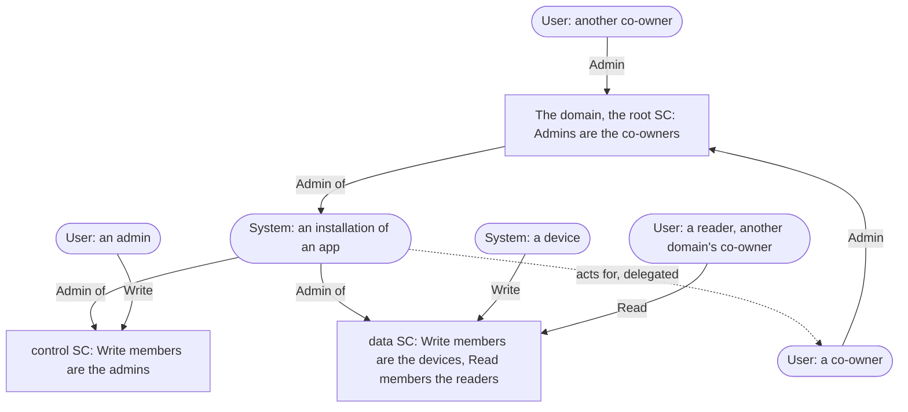
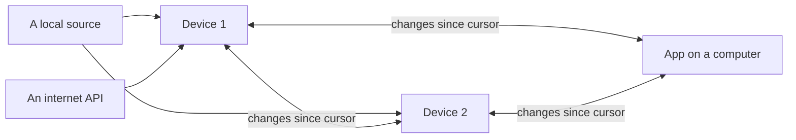

# Bruce's Database: design

bruce-db is a small record store, in Rust, for applications which keep their data both on a computer and on small
devices, such as ESP32 boards with SD cards, and replicate it between them. Every record has a hash key, which names
its DataSet, a sort key, which orders it within the DataSet, and a version, the newest of which wins, so that copies of
a record converge wherever they are kept and in whatever order they arrive. Records are kept in files now, and the
model maps directly onto a single DynamoDB table, for later.

This file is the master copy of the design, begun in November 2026. What is built is the record model, IDs, the file
backend, compaction, the change feed and blobs, see `src/`; what is planned is marked as such. Its first user is
[Bruce's Smart Home](https://github.com/bruceskingle/bruce-smart-home), a desktop app and the ESP32 capture devices
which poll its sources, whose own use of the store is described in that repository's `docs/Store.md`.

## Summary

- **One model for everything an application keeps.** Every **DataSet is a hash key**, and each record in it has a
  **sort key** and a **version**, so that storage, compaction and replication are designed once, not for each kind of
  data. A cache of an API's replies, samples from a sensor and a user's own records all fit it.
- **A formal sort key.** The hash key names a DataSet; the sort key makes a time range a query, orders compaction, lets
  a newer version of a record replace the old one, and, by how it is built, gives each flavour of DataSet: single
  record, list, ordered list or series. With both, a record is one item in a single DynamoDB table.
- **Two layers on disk:** an append-only journal, written in the order records arrive, and compacted files, one line
  per record, ordered by sort key. A crash loses nothing that was written; compaction gives the efficient main files.
- **Replication is pulling a peer's changes since a cursor** and putting them, newest version winning, which is
  idempotent, so that any node can pull from any other, and they converge.
- **Small enough for a device**: std only, no async runtime, records given a line at a time, and an index of the
  journal of about 100 bytes a record, so that an ESP32-S3 with 8 MB of PSRAM runs the whole store.

## The record model

A record is identified by its hash key and its sort key, and the copy with the highest version is the record;
everything else is attributes. Three names:

- A **DataSet** is one hash key, e.g. one thermometer's temperature readings, or one account's bills.
- A **kind** is a family of DataSets with the same rules, e.g. every thermometer's readings, and is the part of their
  hash keys after the domain, e.g. `sensor.temperature`. It replaces the tables of an ordinary database: on DynamoDB
  everything is in one table.
- A **flavour** is how a kind's sort key is built, which decides how it is queried and fetched again, see
  [Flavours](#flavours-from-the-sort-key).

| Part | What it is | Example, a thermometer's readings |
| --- | --- | --- |
| Hash key | The DataSet: its domain, its kind, which sets its rules, then which one, e.g. a device and a series | `<domain>/sensor.temperature/441bf6cc7fcc/indoor` |
| Sort key | Where in that DataSet, ordered: e.g. a UTC time in RFC 3339, so that text order is time order, with a suffix when two share a time | `2026-11-04T07:17:10Z` |
| Version | Which copy of the record is newest: a time, and the origin which wrote it | `2026-11-04T07:20:30Z`, `441bf6cc7fcc` |
| Origin | The node that wrote this version: a device's ID, or an app installation's | `441bf6cc7fcc` |
| Attributes | The record itself, JSON | `{"value": 19.9, "unit": "°C", "open": true}` |

Rules:

1. **Newest version wins.** A put with a lower version than the stored one is ignored; equal times are broken by
   origin, the lowest winning, so that every node ends with the same record whatever order copies arrive in.
2. **Versions are times, from the node's clock**, which must be set before anything is put, e.g. by SNTP on a device.
   A record sampled once, by several nodes, can take the time it is of as its version, so that every node's copy ties,
   and rule 1 keeps exactly one.
3. **A record still changing**, such as a period of steady temperature still open, is put again with a higher version
   each time; nothing is rewritten in place.
4. **Deletes are rare**, and a tombstone, a version with no attributes, so that a peer which still has the record
   learns it is gone.

**Best practice for callers, not a rule of the store:** the store does not know which records are a source's data and
which were worked out from them; the application does. It is best to keep what a source sent, an API's reply or a
device's record, as it sent it, and anything computed from it, e.g. a total or a fitted rate, in DataSets of kinds of
their own, read alongside, if it is worth keeping at all. Then what was given can always be told from what was worked
out, and the worked out can be thrown away and computed again. A cache which mixes them loses which figures the source
gave. What is cheap to work out is best worked out by whoever reads it; what is expensive, e.g. text read from a PDF,
may be kept, with the source record's key and version and the version of the code which made it, so that it is made
again when either changes.

The sort key is what earns its place: "a day of temperature" becomes a range on it, compaction keeps one line for
each, and a record's file is chosen from it, not from when it happened to arrive.

## Domains, and hashed IDs

Every hash key starts with a **domain**, the database it belongs to, so that one DynamoDB table, or one peer, can hold
many domains' records, e.g. several households', without their keys meeting. How an application maps its own things to
domains is its choice; Bruce's Smart Home's domains are what its users see.

**Why "domain",** as Windows calls the same idea, a realm in Kerberos, a tenant in SaaS: the records, principals and
Security Contexts of one owner, e.g. a household, or a company. It was called a site until 25 November 2026, when the
design, the code and Bruce's Smart Home were renamed.

### IDs

- **An ID is a hash**: the SHA-256 of the canonical JSON ([RFC 8785](https://www.rfc-editor.org/rfc/rfc8785)) of what
  it is made from, in URL-safe base64 without padding, 43 characters, see `Id::of`. So the schema has one kind of
  identifier, the same everywhere.
- **Rules for what an ID is made from**, which `Id::of` enforces, refusing anything else:
  1. **Every string is normalised to Unicode NFC first**, as RFC 8785 does not, or a name typed two ways gives two
     IDs.
  2. **No arrays.** RFC 8785 keeps an array's order, so the same set in another order would give another ID; an ID's
     input is objects, strings, numbers, booleans and null only.
  3. **Numbers are IEEE doubles**, so an integer beyond 2^53, or an exact decimal, is a string.

  These are only for making IDs: records themselves are stored as they are, arrays and all, and are not
  canonicalised.
- **A thing created is made from its creator's ID, when it was created, and what the creator believed of it then**,
  such as a domain, or a person in a family tree with the name and date of birth thought right at the time. Two people
  who create a record of one subject get two IDs. The name and date of birth are attributes as well, corrected there
  as better evidence comes; the ID never changes.
- **The inputs must differ, and a version 1 UUID makes sure of it.** A hash keeps its input's uniqueness rather than
  making any. So what a created ID is made from should include a UUID of version 1
  ([RFC 9562](https://www.rfc-editor.org/rfc/rfc9562)), or its parts: the time, a clock sequence, and a 48-bit node.
  A device's node can be its factory MAC address; an app, which on iOS cannot read a MAC and on macOS sees a private
  one for each network, makes a node at random once for the installation and keeps it, with the multicast bit set, as
  the RFC says for a node that is not a MAC. Hashed, a MAC is not published.
- **A thing found is made from the fields which identify it**, such as `{"account": …, "meter": …}` for a meter, so
  that any node works out the same ID without asking another, and account and meter numbers stay out of file names and
  partition keys.
- **A hash key is `<domain>/<kind>/<parts>`**, see `hash_key`. Each
  part is an ID or a readable name of lowercase letters, digits, `.` and `-`, at most 42 characters, so that a name can
  never be taken for an ID. A kind is always a readable name, and a device's own ID may stay readable. The canonical
  JSON an ID was made from may be kept in its DataSet, with a sort key such as `#key`, so that the files can still be
  read, and redacted.
- **A sort key is never hashed**, as its order is the point of it.
- **The hash can be changed, later, without changing an ID already made.** An ID of 43 characters, the only kind
  there is, is SHA-256, and always will be. An ID made with another hash, if one is ever needed, starts with that
  hash's name and a `.`, e.g. `sha3.` then its base64, and in file names with its name and a `-` before its hex, so
  that an ID says which hash made it, and old and new are told apart by their form, never by guessing. A thing keeps
  its ID for ever: only IDs made after the change use the new hash. An ID of a thing found, which every node works
  out for itself, e.g. a meter's, must be made with the same hash by all of them, so the domain's root SC says which
  hash its nodes make IDs with, `hash`, `sha256` until it is changed, see Security Contexts. `Id::parse` takes only
  SHA-256's form today.
- **In file names, IDs are hex.** FAT, exFAT and macOS keep the case of a name but ignore it in finding one, so two
  base64 IDs can be one name to the file system. A file name is the 64 lowercase hex characters of the same hash, which
  maps back exactly. A kind with very many DataSets, such as a family tree's people, should split them into 256
  directories by a part of their own, as git does, as FAT searches a directory one entry at a time, as a domain's
  principals are, by the first two hex characters of the principal's ID, see Layout on disk.

### One truth, or each author's

Newest version wins suits records that are copies of one fact, such as two devices' readings of the same meter. It
does not suit, e.g., a family tree in which two people research the same ancestor, find different, overlapping facts,
and may never agree which sources to believe. So each kind says which it is:

- **One truth**: one record, whoever writes it, the newest version winning.
- **Each author's**: each author's records have their own IDs, made from the author's, so a later record from one
  never replaces the other's, and a disagreement stays visible. That two records are one real person is itself a
  record, `same-as`, by the author who believes it, which the other may or may not accept.

### Security Contexts and Principals

The target design, written on 24 November 2026, from Bruce's model, of which the first part is to be built for the
capture devices of Bruce's Smart Home, see "Built and to build" below. Who may do what is controlled by who signs
what, and, for records which need it, by encryption, so that it holds wherever records are copied: a peer, a device
or a DynamoDB table checks signatures, and can store and replicate an encrypted record without reading it.



#### Domains

- **A domain is a root SC:** an SC with no parent, see The SC graph, whose authority is its own Admins, not given by
  an SC above it. In every other way it is an SC like any other, with a key exchange key pair and an encryption key,
  and no signing key of its own: what it allows is decided by its Admins' signatures, as for any SC. The name is
  kept, as a domain is also what owns its principals, see Principals, and the namespace of its records, the
  `<domain>/` which starts every hash key, and its record says what every node of it shares, e.g. the hash its IDs are
  made with, `hash`, see IDs.
- **Its ID must prove itself,** as there is no central register to say whose a domain is, or anyone could claim it. So
  a domain starts differently from any other SC: another SC's ID is made from its creator's principal ID, but the
  founder's principal ID is made from the domain's, see Principals, so the domain's is made from the founder's first
  signing public key, the hash of their next, see Keys, when it was made, `made`, and a `nonce`, so that anyone can
  check that the domain's record is signed by the key its ID was made from. The founder's principal is then made in
  it, with that same first key, and is the domain's first Admin, see Joining. From then on it is like any SC.
- **No keys of its own:** a domain's authority is its Admins, the co-owners, whose keys are pre-rotated, see Keys, so
  that a stolen current key cannot roll them, and which a **backup Admin**, kept offline, can replace, see Replacing a
  key. Keys of the domain's own beside them were considered, on 25 November 2026, and not taken: they would be more
  secrets for people to keep and understand, and a second authority beside the Admins, which could disagree with
  them.
- **Losing every Admin's keys, the next ones too, and the backup's,** loses the domain: no one can add or remove its
  members again. That is the price of having no central authority.

#### Principals

- **A principal** is whoever or whatever acts in the system, of one of two kinds, which are intrinsically different:
  a **user**, a person, or a **system**, a program which acts by itself, e.g. a capture device, or an installation of
  an app. Both behave the same. What sort of system it is, e.g. a device, is its role, which its memberships and what
  is said of it, see DirectoryInfo, say, not its kind.
- **A principal belongs to one domain,** which vouches for it, see its record. A person may be several principals,
  one in each domain they act in as a member, e.g. bruce@skingle.org, bruce.skingle@jpmorgan.com and
  bruce.skingle@db.com: three personas, which nothing public links. So no two of a person's principals share an input
  to their IDs, e.g. a "person ID", nor **a key**, as the same public key in two domains links them for certain; a key
  file may hold several principals, each with keys of its own. That some of them are one natural person is a private
  statement of whoever needs to know it, e.g. an employer's HR, not part of the shared model, and not needed now.
- **A principal is its identity, and what is said of it is separate:** its keys, and its DirectoryInfo, e.g. its name,
  are records of their own about it, which change and end over time, see Keys and DirectoryInfo, so that its identity
  never does.
- **Its ID is its own for life,** made as a created thing's is, see IDs, from its domain, its kind, when it was made,
  a nonce, 48 random bits as hex, so that two made at once differ, its first signing public key, and the hash of its
  next, see Keys: so that a
  principal whose keys are replaced, or who moves to another algorithm, is still the same principal; anyone can check
  that a key is its first without trusting whoever gave it to them, which is what lets a new device or user be trusted
  at all; and its ID says, through its hash, which domain it belongs to, so that no other domain can claim it.
- **The domain comes first,** so a principal's domain is always known when it is made: a new domain's ID is made
  before its first principal, from its first event, see Domains, and a user joining a domain is given its ID before
  their principal is made for it, see Joining.
- **Its record** is what its ID is made from, `domain`, `kind`, `made`, `nonce`, `first`, its first signing key,
  `{"alg": "Ed25519", "key": <public key>}`, and `next`, the hash of its next, with when it was admitted, `at`, and is
  **signed inside the domain**: by an Admin of the domain's root SC, who admits it, e.g. a co-owner admitting a device
  or another person, or, for the domain's first principal, by itself, as the root's creator, see Joining. Once records
  are notarised, the node it is first written to notarises it too. A record whose inputs do not give its ID, or which
  is not signed so, is not counted.
- **Where it is kept:** each principal is a DataSet of its domain, `<domain>/principal/<principal ID>`, holding its
  record, sort key `-`, and its keys, `key/<key ID>`, so that one query gets what is needed to check its signatures;
  its DirectoryInfo is kept apart, by who may read it, see DirectoryInfo. The domain lists its principals in
  `<domain>/principals`, sort key the principal's ID, so that all of them, e.g. 100,000s of a company's, are one query,
  which DynamoDB pages; that list is for the domain's servers and Admins, never given to a client, see Servers and
  clients.
- **Its private keys never leave it.** A system principal keeps them in its own storage: a device in its NVS, an
  installation of an app in its settings, encrypted, as its other secrets are. A user's are in a **key file**, or on a
  secure USB key device, protected by a password, which the app asks for when the user's key is needed, see Subjects and
  actors; one file may hold a user's principals in several domains, each with keys of its own. The password is the
  file's own protection, so that it can be carried to another computer. **Remember on this computer,** which the user
  may choose, also keeps the file's secrets on the computer encrypted with a key in the system's credential store, as
  the app's other secrets are: the Keychain on macOS, the Credential Manager on Windows, the Secret Service on Linux,
  e.g. GNOME Keyring or KWallet, so that it does not ask for the password each time; where there is none, e.g. a Linux
  computer with no desktop, it asks. *Later:* authentication, how a user proves who they are to a node, which encrypted
  content needs; and the user's key held in parts, in memory only, by several tamper-resistant devices on the network,
  e.g. ESP32s, with no copy kept anywhere.
- **Up-to-date key information** is needed to check a very recent signature, as the key may have stopped being valid
  moments ago, which replication has not yet brought. *Later:* a node fetches a principal's keys from their domain
  directly, outside replication, when it needs to be sure.

#### Keys

- **Each key is a record** in its principal's DataSet, sort key `key/<key ID>`, `key/1` for the first: its signing
  key, Ed25519, and its key exchange key, X25519, for keys wrapped for it, see Membership, made together, each naming
  its algorithm; when it became valid, `from`; `next`, the hash of the next key's public keys, which the principal has
  made and keeps offline, unused, as a domain does, see Domains; and, once rolled, lost or stolen, when it stopped
  being valid, `until`: one date, for every reason. There are no certificates, expiry dates or revocation lists.
- **It is signed within its principal's domain:** the first by itself, and it must be the principal record's `first`;
  a later one, when keys are rolled, by the key itself, which must be the one its predecessor's `next` committed to,
  so that whoever has taken the current key cannot roll it; or by an Admin of the domain's root SC, when the next key
  has been lost too, see Replacing a key. Setting a key's `until` is a new version of its record,
  signed in the same way. Another domain its principal is a member in is never asked, see Sharing across domains.
- **A signature names the key it was made with,** `<principal ID>/<key ID>`, and is good if it was made while the key
  was valid, so that what a key signed before it was rolled stays good.

#### DirectoryInfo

What is said about a principal, as a directory would list it: a name, a role in an organisation, a qualification, a
phone number. The model is a claim, as W3C's Verifiable Credentials have them: an **issuer** says something about a
**subject**, and signs it.

- **Each statement is a record,** hash key `<domain>/directory/<subject ID>/<SC ID>`, its subject's statements in one
  SC, as a DataSet is in only one, see Security Contexts, sort key `<issuer ID>#<label>`, the label the issuer's, so
  that an issuer may say several things, e.g. a name for strangers and another for friends, with a phone number only
  in the second, each in the SC of those who may read it. It holds its attributes, e.g. `displayName`, when it was
  made, `at`, and is signed by its issuer.
- **Self-declared or issued by others,** e.g. Bruce says his name is "Bruce", and an employer's HR admin that it is
  "Skingle, Bruce, J", employee 10243636. A system principal's is issued by whoever is responsible for it, e.g. a
  device's by the co-owner who admitted it.
- **Who can read it** is the SC it is in, as for any record, so that, once records are encrypted, a statement for
  friends is read only by them. Where a viewer can read several, which they use is up to them.
- **A user's name for another, e.g. a nickname,** is the user's own, not the other's: it is in the user's own DataSet of
  contacts, `<domain>/contact/<user ID>`, sort key the other's ID, in an SC only the user reads.
- **Now:** only `displayName`, issued by the user themselves, or for a device by the co-owner who admitted it. Other
  attributes, labels, contacts and encryption are later.

#### Replacing a key

- **Routinely,** e.g. to roll it, or to move to a new algorithm, the principal brings out its next key, which signs its
  own record, committing to the one after, and a new version of the old key's record, with its `until` set to now.
- **When the current key is lost or stolen,** the same: the next key, kept offline, rolls it, with the old key's
  `until` set to when it is thought to have been taken, as whoever took it does not have the next key. Other domains
  it is a member in take the new key from its domain, see Sharing across domains, without doing anything.
- **When the next key is lost too,** e.g. both were in one key file which was stolen, the principal's own signatures
  cannot be trusted, so an Admin of its domain's root SC signs a new version of the old key's record, with its `until`
  set, and a record of a new key the principal has made, as the principal is the domain's.
- **Records signed with a key after its `until`** are refused, by the notary's time, see Signed records, which whoever
  took the key cannot set, as the notary checks the signer's time against its own clock. Until notarisation is built,
  a record's own signed time is used, e.g. a membership's `at`, which whoever took the key could set earlier; so a key
  thought taken is best given an `until` well before, and the principal, with its new key, signs again those of its
  records which are good.
- **The end of the chain of trust** is the domain's Admins, back to the key its ID was made from, see Domains. If
  every Admin's keys, current and next, were taken, the domain could not be trusted again; so a domain should have a
  **backup Admin**: a user principal which is an Admin of the domain, whose key file is kept offline, used only to give
  the co-owners new keys, or to remove a co-owner whose keys have been taken. It is marked `backup` in its membership,
  and no Admin but itself can remove it, so that whoever takes a co-owner's keys cannot remove it first. One backup for
  each domain, not one for each principal, so that there are few keys to keep safe. A threshold on the domain, see
  Membership, guards it further.

#### Sharing across domains

*Later,* e.g. for a family tree whose researchers each have a domain of their own. Bruce's Smart Home does not need
it: a person who reads another's domain, e.g. Bruce reading Jeff's, joins it, as a principal of Jeff's domain made for
it, see Joining, and the app shows one domain at a time, as a profile.

- **Sharing is driven by membership:** an SC with a member from another domain, a principal whose ID says its domain,
  or an SC of that domain, is shared with that domain, and so are the SCs below it, see The SC graph, whose members its
  members are, as the graph is one graph across domains. Only adding or removing such a member changes what is
  shared, so the owning domain keeps, beside the membership, an index of what each other domain can see,
  `<domain>/shared/<other domain ID>`, sort key the SC's ID, a Query on DynamoDB.
- **Nothing is pushed:** sharing a record with another domain means it appears in what that domain is served the next
  time it pulls, as all replication is a pull, see Replication. The other domain checks it all, as any node does, see
  Signed records. Among a shared SC's records is the membership naming the other domain's principal, which is how it
  learns that the SC is shared with it; until it has pulled once, it learns it from the principal, e.g. a user told
  they were added.
- **Each way:** the other domain, learning that one of its principals is a member of another's SC, serves that
  principal's DataSet, its record and keys, to the owning domain, which pulls it and its changes from then on, so that
  the owning domain's nodes check the principal's signatures by its own domain's word, e.g. a key it rolls, without
  doing anything.
- **Catching up on a newly shared SC,** with records already in it, is a copy of that SC: its DataSets, each a Query,
  from its list of them, see Security Contexts, with the other domain's own cursor, as a node keeps one through a full
  copy; then it follows the feed.
- **The feed for another domain** is the change feed filtered by what that domain can see, from the index above. The
  domain which pulls keeps its own cursor, and the one serving keeps nothing about it, as any node serving changes
  does, see Replication. A journal of its own for each other domain is only needed if filtering as it is read proves
  too slow.
- **Its cost** follows the domains which really share: each keeps a cursor for each domain it pulls from, and a record
  is served to each other domain with a member in its SC, never to every domain. The hard case is one SC shared with
  thousands of domains, e.g. a public archive, where every write is pulled by all; a hosted copy which the others pull
  from suits that better, decided when there is one.
- **Removing a member** from another domain is as for any member, see Membership: its wrapped keys are deleted, and its
  domain is served nothing more of the SC, nor anything it asks for again.

#### Security Contexts

- **Every DataSet is in exactly one Security Context**, an SC, and so every record in it: the line's `sc`, the SC's
  ID, or, if it has none, the domain's default SC, which the domain's root SC names, so that a store whose records
  all share one SC, as Bruce's Smart Home's do, need not say so on each line. A put naming another SC than its
  DataSet's is refused. So everything in an SC is its DataSets, which the domain lists for each SC as they are first
  written, `<domain>/security.datasets/<SC ID>`, sort key the DataSet's hash key, and copying an SC, e.g. to a domain
  it is newly shared with, see Sharing across domains, is a Query of each, on files and DynamoDB alike. A subject with
  both private and shared records, e.g. a person in a family tree with public facts and private notes, keeps them in
  two DataSets, which also suits encryption.
- **An SC has a key exchange key pair,** X25519, so that a parent SC can hold its keys, see The SC graph, **and a shared
  symmetric key,** 256 bits, for encrypting its records, see Encryption. Both can be rolled, see Rolling keys, and
  each key has an ID, so that a record says which key it was encrypted with.
- **Each of an SC's keys says its algorithms,** in the SC's record, by key ID: the key exchange's, e.g. `X25519`, how
  keys are wrapped for its members, e.g. `HPKE-X25519-SHA256-ChaCha20Poly1305`, and how its records are encrypted,
  e.g. `ChaCha20-Poly1305`. So moving to another algorithm is rolling the SC's keys, see Rolling keys, the new key
  with the new algorithm: records already encrypted keep their key ID, so are still read with the old one, and new
  ones use the new, so that an SC can hold both while its records are encrypted again, as it can hold encrypted and
  unencrypted records.
- **An SC needs no signing key:** what is allowed is decided by who signed it, a principal, and that principal's role
  in the SC, not by holding the SC's keys, which every member, a reader too, may have.
- **Its ID** is made as a created thing's is, see IDs: from its creator's principal ID, when it was created, and its
  first key exchange public key; a domain's is made otherwise, see Domains.
- **Its record,** hash key `<domain>/security.sc`, the DataSet of every SC of the domain, sort key its ID, holds its
  name, its keys' public halves and algorithms, by key ID, see above, its creator, who is its first Admin, for a root SC
  the hash its domain's IDs are made with, `hash`, see IDs, whether its records are to be encrypted, `encrypt`, see
  Encryption, and whether they must be signed, `signed`, see Signed records, and is signed by the creator, or, once
  changed, by an Admin. A domain's **root SC** is the one the domain's nodes are told of when they join it, e.g. a
  device when it is adopted, from which every other SC and member is checked: the domain, see Domains.
- **A domain is made only when a user asks for one,** never by an app on its own: the user's principal, with its key
  file unlocked, creates the root SC and the domain's others, and is the root's first Admin.

#### Membership

- **A member** of an SC is a principal, a user or a system, or another SC, its parent, see The SC graph, with a
  role:
  - **Admin:** adds and removes members, and does what Write does;
  - **Write:** puts the SC's records;
  - **Read:** reads them, which, for an encrypted SC, needs its keys.
- **It is the user who is a member,** not their apps, as the authority is the user's: an app acts for a user by
  delegation, see Subjects and actors, so that the same user using another app tomorrow has the same rights, and
  removing a user removes what their apps may do for them.
- **Its record,** hash key `<domain>/security.member/<SC ID>`, the DataSet of the SC's memberships, sort key the
  member's ID and when the record was made, `<member ID>#<at>`, so that each change is a record of its own, never
  replacing the one before, and the history is there to work through in order, see below, holds the member, its role,
  when it was made or changed, `at`, whether it has been removed, `removed`, and the SC's keys wrapped for the member,
  by key ID, `keys`, and is signed by the principal who made it, whose ID it gives.
- **It is valid** only if that principal was an Admin of the SC when it signed, by a valid membership of its own,
  directly or through a parent SC, back to the SC's record, whose creator is its first Admin, or, for a domain, back to
  the key its ID was made from. A node ignores a membership which is not.
- **The creator is an Admin** until a member record of its own, made by another Admin, says otherwise from then on, as
  co-owners are equals, so that the domain's creator can be removed too; or, for an SC under another, until that SC is
  given a parent SC as an Admin, e.g. the domain, from when its Admins are the parent's, so that removing one from
  the domain removes it from every SC under it, those it made too.
- **Validity is worked out in the order the records were signed,** by their versions, see Versions of signed records,
  later the notary's time: each record is judged only by what the records before it made valid, starting from each
  SC's creator and the domain's first key. So two memberships, e.g. around a loop in the graph, can never make each
  other valid, as each needs an Admin who was valid before it; of two Admins removing each other, the earlier removal
  wins, as the later was signed by someone already removed; and a removal counts against what the removed member
  signed after it. The result is the same on every node, whatever order the records reached it in: a record which
  arrives late, with an earlier time, means working it out again. This replaces working it out in rounds until two
  agree, which needed a limit on the rounds, as two Admins removing each other could go back and forth.
- **A threshold,** which an SC's record may set, `threshold`, says how many of its Admins must sign a change to its
  members, e.g. 2, so that one Admin, or whoever took their keys, cannot change them alone. A change is then a record
  with that many Admins' signatures. Any SC may have one, a domain most of all. Now: 1.
- **Removing a member** is putting its record again, `removed`, with a later `at`, signed, and without its wrapped
  keys, `keys`, so that the SC's keys are no longer kept for it; the old version, with them, goes when it is compacted,
  and from each peer as it replicates the removal. Every node refuses the member as soon as the record reaches it, by
  replication, and three things then protect the SC's records:
  1. **The membership is an access control list:** a server gives a principal no record of an SC it is not a member of
     now, encrypted or not, and nothing it asks for again, so that a removed member who kept a copy of the SC's key has
     nothing to open with it. This needs a server to know who is asking, which signed requests give now, and
     authentication will for reading encrypted records, see Principals.
  2. **Its wrapped keys are gone,** so it can open nothing it fetches later unless it kept the key apart, deliberately.
  3. **The SC's keys are rolled,** see Rolling keys, so that what is written from then on is under a key it never had.

  What is left exposed is what it fetched before, and whatever a server which does not enforce the list gives it, e.g.
  a server which has been taken, or its own copy on a node of its own.
- **A removal is not undone** by putting an older record again, e.g. from a stolen node or a backup, as a record's
  version is its signed time, see Versions of signed records, so an older record put again keeps its older version,
  and the newer one wins, by the store's own rule, on every node and through replication and compaction.
- **A wrapped key** is the SC's key sealed for the member's key exchange public key, as HPKE does
  ([RFC 9180](https://www.rfc-editor.org/rfc/rfc9180), base mode): X25519, HKDF-SHA256 and ChaCha20-Poly1305, so that
  only the member, or, for an SC, the members of that SC, can open it.

#### Servers and clients

- **A server** is a node which keeps a domain's records and serves them, deciding each request, e.g. a capture device,
  or a DynamoDB table and the code which serves it; **a client** is a program a principal reads and writes through,
  e.g. an app. One program may be both, e.g. the app's own store serving the app, but what each part is given differs.
- **The security records are in the root SC:** SC records, memberships, delegations, principals' records and keys, and
  the domain's lists of them, as every DataSet is in one SC, written by the root's Admins, or by whom each record
  says, e.g. a principal its own keys. They are never encrypted, as they hold only public keys and wrapped keys, and
  the domain's servers need them all to decide requests. So a server which has been taken sees who is a member of
  what, as it sees whatever else it holds in the clear: the price of a server deciding.
- **A client is never given a list of members,** not even of an SC whose records it may read and whose key it holds,
  so that a bad member, or a client program which has been taken, cannot learn who else is in it. A server answers a
  client's requests for security records one record at a time, for what it is entitled to:
  - its own principal's records, its own memberships, with their wrapped keys, and the delegations it is the subject
    or actor of;
  - any principal's record and keys, by the principal's ID, to check a signature it has, but never the domain's list
    of principals;
  - for an Admin of an SC, that SC's members, as managing them needs them, e.g. in an admin browser.
- **So a client checks signatures, not authority:** it can tell who signed a record, by their keys, but not that they
  had Write in its SC, which only the memberships say. The server decided that when the record was written, and, once
  records are notarised, its signature as notary says so, see Signed records; a client trusts the domain's servers for
  it, as it trusts them to serve it the records at all.

#### The SC graph

The SCs are the access control for everything: every record is in one, and every right is a role in one, so the graph
of SCs, joined by membership, decides who may do what anywhere in a domain.

- **An SC can be a member of another,** with a role: the parent SC is the member, and the child's membership record
  names it, and holds the child's keys wrapped for the parent's key exchange public key. Every member of the parent is
  then a member of the child, with the lower of its role in the parent and the parent's role in the child, so that a
  reader of the parent does not become an Admin of the child. A member opens the child's keys with the parent's, which
  it opens with its own.
- **A principal's role in an SC** is the best of its paths to it, each worth the lowest role along it: its own
  membership, or a path through parents. A principal removed from an SC still has whatever another path gives it, so
  a page which shows who may do what, e.g. an admin browser, shows each principal's effective role in each SC and the
  paths which give it, not only the memberships.
- **An SC may have several parents,** e.g. an SC shared between two users, see below, so the SCs form a graph, not a
  tree.
- **Loops are allowed:** SC1 a member of SC2 and SC2 of SC1, through any number of others, e.g. SC1's members managing
  SC2 and SC2's reading SC1. Going round a loop never raises a path's lowest role, so a path through one is never better
  than the same path without it, and a role is still the best of the paths, found visiting each SC once; with Admin both
  ways, the two act as one. Closing a loop needs Admin in both SCs, so it gives nothing that an Admin of each could not
  give anyway. Keys still open, as every chain starts from a principal's own membership; and rolling an SC's keys
  wraps them for its own members only, so it does not go round the loop. What loops need is that a membership's
  validity is worked out in order, see Membership, so that two memberships around a loop cannot make each other valid.
- **The shape, for an app:**
  - **the domain,** whose Admins, its co-owners, can see and do everything in it;
  - **an SC for each app,** a child of the domain, e.g. Bruce's Smart Home's, as Admin, so that what one app keeps is
    apart from another's;
  - **under it, what the app needs,** e.g. Bruce's Smart Home's `control`, whose Write members change the devices, and
    `data`, whose Write members are the devices which put records and whose Read members are those who only read,
    e.g. another household; or, for an app whose users each have private data, **an SC for each user,** a child of
    the app's;
  - **an SC two users share,** made by one of them in their own SC, a child of it, with the other added as a member, so
    that it has two ways in.
- **A domain hides nothing from its owners:** as the domain is Admin of each SC under it, its co-owners can read every
  user's private data in it, as the Object Store's customer could, see The Object Store: the target. Someone who needs
  privacy from a domain's owners needs a domain of their own, and to share with it, see Sharing across domains.
- **Its cost:** a node works out each principal's role in each SC when the memberships change, which is rarely, and
  keeps it, rather than walking the graph for each request.
- *Later:* whether an app's Admins may manage its users without reading their data, which Admin, being Read and more,
  does not allow, and which, for an encrypted SC, its keys wrapped for them would undo.

#### Versions of signed records

- **A security or identity record's version is when it was signed,** its `at`, e.g. a principal's, a key's, a member's,
  or, for an SC's record, until it has one, when it was made: not when it was put. So the store's own rule, the newest
  version wins, is the rule for them too, and a record signed earlier, put again later, e.g. from a stolen node, a
  backup or a peer far behind, never replaces one signed later, whoever puts it and wherever. A newer version needs a
  newer signed time, which needs the signer's key. Nothing is kept outside the store for this.
- **Of two versions signed at the same time,** the lower origin wins, as for any record, the same on every node.
- **Once records are notarised,** see Signed records, the notary's time is the version, so that a signer cannot
  choose it either.

#### Subjects and actors

Every request, and every record written, has two parties, named as in OAuth 2.0 Token Exchange
([RFC 8693](https://www.rfc-editor.org/rfc/rfc8693)):

- **The subject,** whose authority is used: their membership says what may be done, e.g. Bruce, a co-owner.
- **The actor,** which does it for the subject: e.g. the installation of the app Bruce is using. It is named for the
  record of who did what, and it signs too, so that the actor is not merely claimed.

There are three cases:

- **The subject is present,** e.g. Bruce adding a member, his key file unlocked with its password: the subject signs,
  and the actor signs as well. The authority is the subject's alone; the actor needs no role of its own.
- **The actor acts for the subject while they are away,** e.g. the app replicating a device every few minutes, or
  polling a source as a fallback, when the user's key is locked away: the actor signs alone, naming the subject and
  the **delegation** which lets it, see below. What it may do is the lower of the subject's role and the delegation's.
- **A system principal acting for itself,** e.g. a device reading a peer's store, is both subject and actor, and signs
  once, with a membership of its own.

**A delegation** is a record, signed by the subject, which says that an actor may act for it in the domain, up to a
role, e.g. "Bruce's Smart Home on Bruce's MacBook may act for Bruce, up to Write", from when, and, once ended, `until`,
as a key's validity ends: no expiry date. In each SC, the actor may then do the lower of the subject's role there and
the delegation's, and a delegation is never of Admin, so that adding or removing a member always needs the subject
itself. Its hash key is `<domain>/security.delegation/<subject ID>`, the subject's delegations, sort key the actor's ID,
so that a node checking a request gets it, and a page listing what acts for a user queries one DataSet. It is valid
while the subject's membership is: removing the subject ends what its actors may do too. A user delegates to each
installation of the app they use, e.g. when it joins a domain for them, before they are a member, as it gives nothing
until they are one.

#### Signed requests

- **A request to a node** carries `Authorization: Bruce-Signed`, with the subject, the actor and the time:
  `subject=<principal ID>/<key ID>:<signature>, actor=<principal ID>/<key ID>:<signature>, time=<time>`, each in its
  key's algorithm, the signature of `<method> <uri> <time> <SHA-256 of the body> <subject ID> <actor ID>`, so that
  neither can be swapped; for a delegated request, the subject is its ID alone, `subject=<principal ID>`, unsigned,
  and the node finds the delegation from the two IDs; and for a system principal acting for itself, the shorter
  `Bruce-Signed <principal ID>/<key ID> <time>:<signature>`, of the same bytes with itself as both, is the same thing.
- **The node checks** that the time is within its margin, 5 minutes, of its own clock; each signature against its
  principal's record, by the key valid now; then the subject's role in the SC the request is for, or, if delegated,
  the delegation and the lower of the two roles. It answers a request it cannot tell the signer of, e.g. an unknown
  principal or a wrong signature, 401, and one signed as it should be by someone whose role does not allow it 403, so
  that a client knows whether its signature, or its authority, is the trouble.

#### Signed records

- **Every record is signed by its subject,** or, if delegated, by its actor, with the subject and actor named, as a
  request is, in the final design: until that is built, a node trusts the records of the peers it replicates from,
  which are themselves members, until they are removed.
- **The edge server,** the node a record is first written to, e.g. the capture device a poll ran on, or the app's
  store for what the app puts, checks the record's signatures, and that the signer's time on it is within its margin
  of its own clock, refusing it if not, then **notarises** it as it writes it: it signs the record, as signed, with its
  own time, `notary: {"by": <principal ID>/<key ID>, "at": <time>, "sig": <signature>}`. Its time is the record's time
  for every check after, a key's validity, a member's, a delegation's, and its version, see Versions of signed
  records, so that whoever takes a key cannot backdate what they sign with it.
- **Every node it reaches by replication checks it all again:** the subject's and actor's signatures, the notary's, and
  that each was valid at the notary's time, trusting the notary, which is a node of the domain, a member with Write in
  the record's SC, to have checked the time. It refuses a record which fails, or whose notary is not trusted, logs it,
  and still replicates the rest from that peer, as the rest of what it sends may be good.
- **Signatures name their keys,** `<principal ID>/<key ID>`, whose algorithm the principal's record gives, so a line
  needs to say only who signed it and with which key, and records signed with different algorithms sit side by side.
- **What is signed** is the record as the store keeps it, not how it travelled: the hash key, sort key, version, SC,
  and `a` or `enc`, so that an encrypted record is signed as ciphertext, and a node checks it without reading it; the
  notary signs that and the subject's and actor's signatures. Where it was pulled from, `from`, its sequence number
  and when it was stored are each node's own, and not signed.
- **The signatures are kept with the record** through compaction, replication and copying, so that it is checked again
  by every node it reaches, and a record keeps its subject, actor and notary whichever nodes it passed through.
- **The checksum stays**, as it is cheap and finds a damaged line before a signature is checked.
- **The cost:** signing a put, and checking each record replicated, takes an ESP32-S3 a few milliseconds a signature,
  three for a delegated and notarised record, which suits a device's own puts, a few a minute, but makes a full copy
  of a large store, e.g. 160,000 records, take minutes longer; batch verification, which Ed25519 allows, is to be
  measured first.
- **Moving a store over:** records written before carry no signature. The SC's record says whether its records must be
  signed, `signed`, changed by an Admin, as `encrypt` is: until it is true, a node accepts an unsigned record from a
  member peer; once it is, it refuses one. An SC's records are signed by putting each again, a new version, by a
  member who may write, as encrypting them is.

#### Encryption

**Optional, for each record.** An SC whose records are private, e.g. records shared between people, or kept in a shared
DynamoDB table, encrypts them with its shared key; one whose records are not, e.g. Bruce's Smart Home's, which are
the household's own and on its own devices, does not, and its keys are made all the same, so that encryption can be
turned on later.

- **Each record says whether it is encrypted:** it has `a`, its attributes as JSON, or `enc`, the envelope below,
  never both, so that the code tells them apart without guessing.
- **An SC may hold both,** e.g. while it is being encrypted, or a kind whose records need no secrecy beside one whose
  do; every reader handles either, record by record.
- **The SC's record says what is to be written,** `encrypt`, true or false, changed by an Admin, signed as its
  memberships are: while it is true, a member's node encrypts each record it puts in the SC, and, once records are
  signed, see Signed records, a node refuses an unencrypted one, so that a member cannot write one in the clear by
  mistake.
- **Encrypting an SC's records** is turning `encrypt` on, then putting each record again, a new version, encrypted, as
  any member who may write does, a DataSet at a time; **decrypting them** is the reverse. Until the last is put, the
  SC holds both, which is harmless.
- **What was in the clear stays as it was** where it was copied before, e.g. a peer's kept journal hours, a backup, or
  another node's store until it replicates the new version; encrypting protects what is written from then on, not
  what has already left.
- **An encrypted record** has `enc`, `{"key": <key ID>, "ct": <base64 ciphertext>}`: the key is the SC's, which the
  line's `sc` names, and the key ID says which of its keys, as they can be rolled.
- **Only the attributes are encrypted.** The hash key, sort key, version and origin stay in the clear, as the store
  needs them to put, query, compact and replicate, so a peer, a device or DynamoDB does all of that without being able
  to read a record. They show which DataSet and when, not what, and hashed IDs keep the which opaque.
- **The ciphertext is bound to its record**: an AEAD cipher, ChaCha20-Poly1305 or AES-256-GCM, with the hash key, sort
  key, version and SC as associated data, so that it cannot be moved to another record or SC, or passed off as another
  version.
- **Reading encrypted content needs authentication,** a user proving to a node who they are before it gives them
  wrapped keys or ciphertext to open, which is later work, see Principals.

**Unencrypted attributes stay JSON**, not base64: base64 of plain text hides nothing, is a third bigger, and loses what
JSON gives, files people can read, redaction, and DynamoDB maps a filter can look into.

#### Rolling keys

When a member who could read is removed, an Admin makes the SC a new key, with a new ID, and puts each remaining
member's record again with it wrapped too; records already written keep the key they were encrypted with, and new ones
use the new key, so that the removed member, who may have kept the old one, could not read what is written after even
from a server which gave it to them. It is the third of the protections a removal gives, see Membership.

#### Joining

- **Making a domain** is a user's explicit choice, see Security Contexts: their app makes, in their key file, a key
  for them, and its next, and from them the domain's ID, see Domains; then the user's principal in it, with the same
  first key, then the domain's record, which the principal signs as its creator and first Admin, the principal's
  record, and the domain's other SCs, e.g. the app's. The app then offers to make a backup Admin, see Replacing a key,
  in a key file of its own, to keep offline, e.g. on a USB stick in a drawer.
- **A user joins a domain,** e.g. a co-owner's partner, an employee, or a friend who is to read its devices, by
  becoming a principal of it, made for it:
  1. A co-owner gives them the domain's ID, e.g. in an invitation, as a file, or later by email, none of it secret.
  2. Their app makes the principal, with the domain in its ID, its first key and the user's DirectoryInfo, in their
     key file, and sends a request, with the app's own principal, for the record of who acted, none of it secret
     either.
  3. A co-owner, their key file unlocked, signs the principal's record into the domain, puts the records and the
     user's membership, e.g. Read in `data`, and sends back the domain's root SC's ID and where its nodes are, e.g. the
     devices' addresses and their certificates' fingerprints.
  4. The joining user's app has them sign a delegation to it, see Subjects and actors, puts it at a node, and reads the
     rest from a node.
- **A user of another domain whose own principal is to be a member** is for sharing across domains, later, see there.
- **A device** is a system principal of the domain, its record signed into it by the co-owner who adopts it, with
  its `displayName`, and its membership of `data`.
- **A user already a member** is given more by a new membership record alone, and **another app of theirs** needs
  only a delegation from them, signed on that app, as the authority is theirs.

#### Built and to build

1. **First, for Bruce's Smart Home's capture devices,** built 24 November 2026 for 0.4.0, in a module of bruce-db,
   `security`, used by the app and the devices alike: principals, with their keys listed by key ID, both pairs; SCs and
   their records; membership records, signed and checked, with one level of nesting; the latest `at` of each member kept
   by each node; and signed requests, naming their keys, checked by role, for a principal acting for itself.
2. **Next, with joining in Bruce's Smart Home,** built in bruce-db on 24 November 2026 for 0.4.0: one validity date,
   `until`, for a key, in place of retired and revoked; user and system principals; subjects and actors on requests,
   both signing; delegations, kept, with the latest member records, in a file of each node's own, outside the store,
   which 3 replaces. In the app: the user's key file, protected by a password, and making a domain only when a user
   asks.
3. **Then, designed on 24 November 2026, built on 25 November 2026 for 0.4.0:** principals as DataSets of their domain,
   each with its record, signed into the domain, its keys and its DirectoryInfo, with `displayName` only, and the
   domain's list of them; `kind` only user or system; `nonce` in place of `node`; and versions of security and identity
   records from when they were signed, so that nothing about them is kept outside the store; the domain in each
   principal's ID; a DataSet in one SC, with the domain's list of each SC's DataSets; joining by an invitation first;
   and "remember on this computer" for the key file. Designed then too, as they change what IDs are made from: the
   domain's ID from its founder's first key, see Domains, and `next` in each principal's record and keys; servers giving
   clients security records one at a time, never a list of members, see Servers and clients; and, on 25 November 2026,
   the SC graph, with an SC for each app, see The SC graph, and validity worked out in the order records were signed,
   see Membership. Sharing across domains is later. As built: `Founding` makes a domain and its founder; `NewPrincipal`
   a principal, its record signed by itself until an Admin admits it, `PrincipalRecord::admitted_by`; `KeyRecord`s, each
   committing to its next; `DirectoryRecord`s; each change to a membership a record of its own; principals' and
   DirectoryInfo's DataSets split on disk by their IDs' first two hex characters; and `Security::sees_security_records`
   and `is_security_data_set`, with which a node leaves the security records out of a client's change feed. Not built
   then: a DataSet's SC on its lines, and the domain's list of each SC's DataSets, as every record of Bruce's Smart Home
   is in one SC; a client's request for one principal's record by its ID; and "remember on this computer", in the app.
4. **Later, to complete it:** replacing keys, and the backup Admin, see Replacing a key; thresholds, see Membership;
   SCs for users, and shared ones, see The SC graph; every record signed by its
   subject, notarised by its edge server and checked by every node, see Signed records; fetching a principal's record
   from its authoritative source; authentication; wrapped keys in membership records; encrypted records; rolling keys;
   a user's key held in parts by several devices. Each adds a field or a step, and changes nothing
   built before.

The crates: [ed25519-dalek](https://crates.io/crates/ed25519-dalek) and x25519-dalek, BSD-3-Clause, approved in general
on 17 November 2026; chacha20poly1305, hkdf and, for the key file, argon2, MIT or Apache-2.0; checked with
`cargo metadata` for what they pull in before they are added.

## Keys for each kind

An application designs each kind's keys: which fields make its hash key after the kind, its sort key and its version,
and which node writes it. For example:

| Kind | Hash key, after the kind | Sort key | Version | Written by |
| --- | --- | --- | --- | --- |
| `sensor.temperature` | device ID / series | period start | period end | the device with the sensor |
| `meter.reading` | hash of account and meter | slot | slot, ties broken by origin | every node that reads the meter |
| `account.bill` | hash of account | issued date, then the bill's ID | fetched | whichever node fetches the account |
| `device.start` | device ID | start time | written once | the device |

When several nodes sample the same source, e.g. a meter on the local network, their copies of a slot differ a little,
taken moments apart, so a slot is one record: its version is the slot, and of equal versions the lowest origin wins,
the same on every node. If that node misses a slot, another's copy fills it. Before the winner's copy arrives a node may
show another's for a while; then it is replaced.

### Flavours, from the sort key

The usual flavours of DataSet are each a way of building the sort key:

| Flavour | Sort key | Fetched again |
| --- | --- | --- |
| Single record, e.g. an account | a constant, e.g. `-` | each fetch puts a new version |
| List | the record's own ID | each record fetched is put; one no longer returned is a tombstone |
| Ordered list, e.g. bills | its order then its ID, `2026-10-01#<bill>` | from the first record not final |
| Fetched series, e.g. an API's half-hourly consumption | the record's time; a month is the range `2026-11` to `2026-12` | what is missing or not final, found by a query of the range |
| Captured series, e.g. sensor samples | the record's time | never; it is sampled once |

- **What a DataSet knows of its own fetching** can be records too, in the same DataSet, with sort keys starting `#`,
  e.g. `#fetched/2026-11`: when that month was fetched and whether it is complete. `#` sorts before every digit, so a
  time range never includes them, and they replicate with the data, so a node which takes over fetching knows what has
  been fetched.
- **Fetching again is a new version**, which replaces the old wherever it has been copied, so data a source revises
  later, e.g. a supplier's re-rated readings, is picked up by fetching it again.
- **An API's reply may be split into records**, each item's JSON as the source sent it, with a `#fetched` record saying
  what was asked for and when. Splitting is allowed; changing a value is not, see the best practice above.
- **The rules stay with the application**: when to fetch again and what counts as final are its own; it reads what is
  kept by a query.
- **An item is at most 400 KB** on DynamoDB, so a series keeps a record per sample or slot, not a month of them, and
  large files go in the blob store, see [Blobs](#blobs).

## Layout on disk

Each node writes every put to a journal, and compaction later folds the journal into each DataSet's files, by sort key,
one line a record. A domain is a directory under the store's root, and a DataSet a directory under it, its hash key's
parts as the path, holding one file, or, for a series, a file a day.

```
<root>/<domain hex>/
  journal/2026-11-04T07.jsonl                   every put of an hour, in arrival order: {"n","t","from","o","hk","sk","v","a","c"}
  journal/kept/                                 the journal's hours once compacted, kept a while for peers catching up
  format.json                                   the layout's version, 2
  state.json                                    the store's ID, the last sequence number, the latest compacted
  sensor.temperature/441bf6cc7fcc/indoor/
    2026/11/03.jsonl                            a series: a file a day, by sort key, newest version
  account.bill/<64 hex characters>/records.jsonl  sort keys which are not dates: one file
  blobs/ab/<64 hex characters>                  a blob, by its ID's hex
  principal/ab/<64 hex characters>/records.jsonl  a principal: its record and keys, split by its ID's first two hex
                                                characters
  principals/records.jsonl                      the domain's list of its principals
  directory/ab/<64 hex>/<64 hex>/records.jsonl  a principal's DirectoryInfo in one SC: the principal's ID, then the SC's
```

- **Every ID in a path is hex,** never base64, see IDs: macOS's and FAT's file systems keep a name's case but ignore it
  in finding one, so two base64 IDs differing only in case would be one file.
- **No directory grows large:** a domain holds its kinds, each kind its DataSets; where a kind may have very many, e.g.
  a company's principals, they are split into 256 directories by the first two hex characters of their IDs, as git
  splits its objects and as the blob store does, as FAT searches a directory one entry at a time.

- **Each line ends with its checksum**, `"c"`, a CRC32 of the line's JSON before it was added, so that a line damaged
  on the disk, e.g. with a bit flipped by a failing SD card, is found when it is read, even if it is still JSON. A line
  which can not be read, not UTF-8, not JSON or not as its checksum says, is skipped with a warning, and the rest of
  the file read on from the next newline, so that the damage is only that line's; one without a checksum, written
  before 0.3.0, is taken as it is. A record whose line is damaged is missing, even when the line was indexed before
  it was damaged, so that a read gives none rather than an error, and compaction goes on without it; and a copy of the
  same version, e.g. sent again by a peer, is stored in its place, so that a peer can repair it, see "Repair" in
  Replication.
- **The journal is the only file written as records arrive**: appends and, unless the caller says otherwise, see
  `Store::set_sync`, a sync after each, so that a crash loses at most the line being written. Each line has `n`, its
  sequence number in the node's store, one more than the last, which orders the change feed and is the replication
  cursor, and `t`, when it was stored, for people to read. The node is its store's only writer, so the numbers are
  never given twice or out of order, and no clock is involved; the last is kept through compaction, in `state.json`.
- **The journal is indexed in memory**: for each record its newest line's sequence number, version and where the line
  is, not its attributes, which are read from the file when wanted, about 100 bytes a record. A day of 10 second
  samples is about 10 MB of lines but 1 MB of index. Opening a store reads the journal to build it; a put, get or query
  reads only what has been added since, by this process or another.
- **Compaction** folds the journal's days before a date into the DataSets' files: for each file, it merges the file's
  lines with the journal's newest line of each record for it, a line at a time in sort key order, streamed from the
  index, writes the result to a temporary name and replaces the file with it, then deletes the journal's days. An hour
  of steady temperature, put a minute at a time, becomes one line. It stops between files when cancelled, leaving the
  journal to compact again, which gives the same files. This is to change to an hour's journal at a time, see
  [The journal by the hour](#the-journal-by-the-hour).
- **A query** for a range reads the compacted files for it, then the journal, newest version winning.
- **Replacing a file on FAT**: a rename onto an existing file replaces it on macOS and Linux, but fails under ESP-IDF
  with "File exists". So the old file is moved aside, to `.old`, the new one renamed into place, and the old deleted; a
  crash between leaves only the `.old`, which is put back when the file is next read, and the journal, only deleted
  once compaction has finished, gives the same file again.
- **FAT32 or exFAT is fine**, so that a device's card can still be read in a computer; the SD card's controller does
  the wear levelling, and the journal's sequential appends suit it.

### Blobs

Files, e.g. a PDF, go in a blob store beside the records, named by their ID, the SHA-256 of their contents, see
`Store::put_blob`; a record refers to its blob by its ID. Files on disk now, and an object store beside DynamoDB
later. A node with little space, e.g. a device, may choose not to keep or replicate large blobs.

### DynamoDB

Planned. DynamoDB maps directly onto a single table, `hk` its partition key and `sk` its sort key, with the domain as
the hash key's first part.

| Attribute | Type | Example |
| --- | --- | --- |
| `hk` (partition key) | String | `<domain>/sensor.temperature/441bf6cc7fcc/indoor` |
| `sk` (sort key) | String | `2026-11-04T07:17:10Z` |
| `v` | String | the time, then the origin's ID inverted |
| `o` | String | `441bf6cc7fcc` |
| `a` or `enc` | Map | `{value: 19.9, unit: "°C", open: true}` |
| `w` | String | the domain and the writer, the node which put it, the change feed's partition key |
| `n` | Number | the writer's sequence number of the put, the change feed's sort key |
| `t` | String | when it was stored, for people to read |
| `deleted`, `ttl` | Bool, Number | only on tombstones, so that DynamoDB's TTL clears them in time |

- **The version is one string**, the time then the origin's ID with each byte inverted, so that comparing strings is
  rule 1, the lowest origin sorting highest, and a put is conditional on it: `attribute_not_exists(hk) OR v < :v`. A
  refused condition is `Put::Older`. Unlike the journal, DynamoDB only ever holds the winning version.
- **A DataSet is one partition**, and a range a `Query` with `sk BETWEEN`, which includes both ends, so the end is
  dropped by the client; `begins_with(sk, "2026-11")` gets a month.
- **The change feed is a global secondary index** whose partition key is the domain and the writer, `w`, the node which
  put the item into the table, and whose sort key is that writer's sequence number, `n`, from its own store. Many nodes
  write to the one table, so no one sequence orders its changes, and a time would not do: clocks differ, and a write
  can land just after a reader has read past its time. So a reader's cursor is a sequence number for each writer,
  `{"app-3f…": 1042, "441bf6cc7fcc": 88}`, each read from its own partition, and nothing is missed or read again.
- **Checking a design against DynamoDB,** each time it changes, as Bruce asked on 24 November 2026:
  - **Every lookup is a Get or a Query** of a hash key the node can work out, never a listing of DataSets, which
    DynamoDB cannot do but by scanning the whole table: `data_sets`, which the file backend does cheaply, has no cheap
    equivalent there, so nothing which must work on DynamoDB depends on it. Records looked up together are one
    DataSet where they belong together, e.g. an SC's members, or each principal's record, keys and DirectoryInfo.
  - **The high-entropy part is first:** every hash key starts with the domain's ID, a SHA-256, then the kind. DynamoDB
    places an item by a hash of its whole partition key, so keys which share a start scatter anyway, but the rule
    costs nothing and holds for any store ordered by key.
  - **No DataSet takes a domain's heavy traffic,** as a hot partition comes from one busy key value: a series is a
    DataSet for each source, and the change feed's index a partition for each writer.
  - **The same hash keys** in every backend, `/` between their parts, which is not in the URL-safe base64 of IDs, so
    that a record is copied between backends as it is.
  - **An item and a DataSet stay small:** an item at most 400 KB, a DataSet's records of a few kinds, not thousands of
    kinds.
- **Not DynamoDB Streams for the feed**, as they keep only 24 hours, too short for a node away for longer, and the feed
  must be the same pull, from a cursor, as between files, so that every peer replicates one way.
- **Pushing changes as they happen, later**: Streams can feed a Lambda which publishes to SNS, SQS or WebSockets, so
  that a node learns of a change at once rather than at its next pull. That is a notification, saying a writer has put
  changes up to a sequence number, not the data's only path: a subscriber still pulls from its cursor, so one which
  missed notifications catches up the same way.
- **Each node keeps a file store of its own, and DynamoDB is a peer**, replicated with as any node is, rather than
  replacing a node's store, so that every node works offline. Which backends are built is chosen by Cargo features,
  `dynamodb` for computers only; which one a store uses is its location, e.g. `file:///…` or
  `dynamodb://<table>?region=…`, given to `Store::open`, so that no code outside the crate names a backend.

## Operations and the backend

A few operations cover every store, behind one trait, `Backend`, so that the files now and DynamoDB later are two
implementations of it. `Store` wraps it for a domain, see `src/lib.rs`.

```rust
pub trait Backend: Send + Sync {
    fn store_id(&self) -> String;
    /// Stores item unless a copy as new is stored; from is the peer it was pulled from.
    fn put(&self, item: &Item, from: Option<&str>) -> Result<Put>;          // Put::Stored | Put::Older
    fn get(&self, hk: &str, sk: &str) -> Result<Option<Item>>;
    /// The newest version of each record of the DataSet hk with a sort key in range, in order, one at a time.
    fn query(&self, hk: &str, range: Range<&str>, visit: &mut dyn FnMut(Item) -> Result<Flow>) -> Result<()>;
    /// Every change stored after since, in the order stored, up to limit, but those from or originated by for_peer.
    fn changes(&self, since: Cursor, limit: usize, for_peer: Option<&str>,
               visit: &mut dyn FnMut(Change) -> Result<()>) -> Result<Cursor>;
    fn data_sets(&self, prefix: &str) -> Result<Vec<String>>;
    fn compact(&self, before: Date, progress: &mut dyn Progress) -> Result<()>;
    fn put_blob(&self, bytes: &[u8]) -> Result<Id>;
    fn get_blob(&self, id: &Id) -> Result<Option<Vec<u8>>>;
    fn set_sync(&self, sync_each_put: bool);
    fn sync(&self) -> Result<()>;
}
```

- **Visitors, not vectors**: results are given a record at a time, so that a device never holds more than a line, and
  an application can stream into its pages. `query_all` and `all` collect them, for small DataSets.
- **Locking**: a store takes a file lock on its journal while it appends or compacts, so that two processes on a
  computer can share a domain; a device has one writer, and no lock.
- **Std only, no async runtime**, so that it builds for ESP-IDF as well as macOS and Linux; an async application calls
  it from a blocking task or a thread of its own.
- **The policies stay with the callers**: when to poll, when to fetch again, what counts as final, and when to compact.

## Using the crate

- **Opening**: `Store::open("file:///<root>", &domain)` makes the domain's directory if it is not there, gives the store
  its ID, and reads the journal into the index, which takes time in proportion to the journal, so a store is best
  opened once and shared, e.g. in an `Arc`, rather than opened for each use.
- **Compacting is the caller's to schedule.** `Store::compact(before)` folds the journal's days before `before`. Leaving
  a day, e.g. compacting the days before yesterday, keeps late records in the journal a while, though merging is newest
  version wins, so a late record is never lost either way. It holds the store while it runs, so puts, gets and queries
  wait for it: an application should run it on a thread of its own, away from its start, e.g. a minute after opening
  and then hourly, which costs only a listing of the journal when there is nothing to fold. Nodes which share a
  workload should not all compact at once. `compact_with_progress` reports how far it is and can be cancelled, for a
  large journal, e.g. after a bulk load.
- **Bulk loads**: `set_sync(false)` skips the sync after each put, and `sync()` at the end makes it durable.
- **Logging** is with the `log` crate, target `bruce_db`: warnings, e.g. a journal line which cannot be read, and at
  info, how long opening and compacting took, and any refresh of the index which took over a second. An application
  which wants them in its own log installs a `log` logger.
- **Errors** are `anyhow` errors, with their chain of causes.

### On a device

- **A board needs PSRAM** for the index, e.g. an ESP32-S3 with 8 MB. ESP-IDF gives an allocation below
  `CONFIG_SPIRAM_MALLOC_ALWAYSINTERNAL`, 16 KB by default, from internal RAM first, so the index's many small
  allocations would use the internal RAM that TLS and DMA need: set it to 0, keep
  `CONFIG_SPIRAM_MALLOC_RESERVE_INTERNAL` for DMA, and measure.
- **A board without PSRAM** can still append records in the journal's format and give them as a change feed, a line at
  a time, for a peer to pull, without the index, compaction or queries; the crate does not do this yet.
- **Long file names**: ESP-IDF needs them on, `CONFIG_FATFS_LFN_HEAP`, and `CONFIG_FATFS_MAX_LFN` of 255, which a hash
  key's parts, 64 hex characters for an ID, fit within; and exFAT on for cards formatted that way.
- **Few open files**: a FAT mount allows only as many files open at once as its `max_files`, e.g. 4, so the crate
  keeps as few open as it can, one for the journal's lines while compacting, and a mount should allow at least 4.
- **The clock** must be set, e.g. by SNTP, before anything is put, as versions and the journal's days come from it.
- **Log with the `log` macros**, never `println!` or `eprintln!`, which panic on a device with no computer reading its
  USB port.
- **A crash while compacting** may happen again at once on restart, so a device should keep a guard, e.g. a file
  written before compacting and removed after, and not compact again in a build which crashed doing it, until the
  crate's own guard, see [The journal by the hour](#the-journal-by-the-hour).

## Replication

Every node pulls each peer's changes since the cursor it last got and puts them into its own store; because the newest
version wins, the order and repeats do not matter, and the nodes converge.



- **The feed** is `changes`, which an application serves over its own transport, e.g. a device's HTTP API, a page at a
  time, e.g. `GET /api/store/changes?since=<sequence>&limit=500`, with each change as a journal line,
  `Change::to_json`. A node's store has one writer, itself, so the cursor a peer keeps for it is one number, the
  sequence number of the last change it got.
- **A store has an ID of its own**, `store_id`, made when it is first made and kept in `state.json`, which the feed
  should give with each page, so that when a store is replaced, e.g. a device's card is wiped and its sequence numbers
  start again, a peer starts again from 0 rather than waiting for them to pass its old cursor.
- **Replicated records are passed on**, as a node's own are, so that a record crosses nodes which do not pull from
  each other directly, A to B to C.
- **They cannot loop**: a put that changes nothing, a version a node already has, is not journalled, so a record which
  comes back to a node stops there.
- **Nor go back where they came from**: each journal line has `from`, the peer it was pulled from, beside `o`, its
  origin, and the feed for a peer leaves out the lines from it or originated by it, as routing protocols' split
  horizon does, so a record does not even make the one wasted trip back.
- **A node serving changes keeps no state about its clients.** Each request carries all that is needed, its cursor; a
  node never remembers its peers' cursors, nor waits for them, e.g. to compact only what every peer has read, which
  would work for a handful of nodes but ties them together.
- **Repair**, planned: a line damaged on a node's disk is missing there, see the checksum in [Layout on
  disk](#layout-on-disk), but its peers have the record, and the feed will not send it again, as the node's cursors
  are past it. So the store notes each place where it found a damaged line, a DataSet's file or a journal hour, in a
  file of its own which does not replicate, `Store::damaged`, and the application asks a peer for that place again:
  for a DataSet's file, a copy of that file alone; for a journal hour, the peer's changes again from the cursor it had
  for that peer when the hour began. Neither leaves out what the node asking made, as the feed for a peer does, as
  that is what it may have lost. What comes back is the same version as the damaged line, which a put stores in its
  place, so the next compaction writes the file whole, and the place is marked repaired once a peer has answered.
- **Who fetches what is the application's choice**, e.g. every node samples a local source, so that any one keeps going
  alone, while one node owns each internet source, to spare its rate limits, and the others get its records by
  replication.

## The journal by the hour

Planned, agreed on 13 November 2026, after devices running the store had run out of memory compacting several days of
journal at once, and an application had been slow to start. The size of the journal was behind every symptom: opening
a store reads and parses all of it; compaction listed every record of the days it folded on top of the index, since
fixed to stream; and the change feed walks the whole index for each page, about 9 seconds a page of 500 on an
ESP32-S3. So the journal is to be kept small, and nothing is to be done in one big piece.

The principle, beside the stateless server above: **nothing reads in proportion to the size of the store**, except a
full copy, which reads it once, a page at a time. A query reads its DataSet's files for its range, opening reads the
journal not yet compacted, and catching up reads what is new.

- **A journal file an hour**, e.g. `journal/2026-11-13T06.jsonl`, rather than a day, as a journal file can only be
  deleted whole, so its length sets how small a step compaction can take. The daily files of stores made before are
  read as long segments until they are compacted.
- **Compaction a little and often**: an hour is compacted soon after it ends, a DataSet's file at a time, each a short
  step, so that puts wait for at most one, and a crash loses at most one. No grace period is needed for correctness, as
  merging is newest version wins: a late record lands in a later hour and is merged into its file when that hour is.
  There is no special time of night, and no two nodes need to avoid each other's.
- **Appending, not rewriting**: a time series' records nearly always sort after everything already in its file, so a
  step mostly appends to the end of the day's file, and rewrites it, merged, only when a record falls inside it, which
  keeps the writes to an SD card down.
- **A crash guard**: a node notes the step it is taking, and one which starts to find a step unfinished skips that
  file and reports it, rather than crash on it again.
- **Only the hours not yet compacted are in the index**, so opening reads an hour or two, parsing only each line's
  head, `n`, `o`, `hk`, `sk` and `v`, not its attributes, which on a Mac takes a third of the time of parsing the whole
  line.
- **Compacted hours are kept**, read only and out of the index, for a retention period, a few days by default, then
  deleted, so that a peer catching up reads them, in sequence order, rather than the compacted files, which are in
  sort key order and can only be searched for a sequence number by reading all of them. The retention must comfortably
  outlast a full copy by the slowest peer expected.

The change feed then has two paths, and an answer for the gap between them, never a scan of the whole store:

- **Catching up**, a `since` within the journal kept: the node finds the hour file holding `since`, by its first line,
  and reads forward. It may give a version since superseded, which is harmless, as the newest version wins.
- **Too far behind**, a `since` older than the oldest hour kept, or one which the hours kept do not reach from without
  a gap, e.g. an hour lost from a failing SD card: the answer says so, and the peer makes a full copy. The node knows
  each kept hour's first and last sequence numbers, reading each once, its first line and its last, and again only
  when it grows, and the journal's own, and checks that together they hold every one from `since` to the newest
  compacted. An hour put to again after the clock was set back is taken as holding everything between its first and
  last lines, which the hours after it do.
- **A full copy**, `copy`, built for 0.4.0, walks the DataSets' files in the order of their paths, each in sort key
  order, having first taken the newest sequence number compacted as its watermark, or one before the journal's first
  line, if that is earlier, as after the clock was set back: not the node's latest, as what is still in the journal is
  not in the files, and comes from catching up after it. Its token carries the store's ID, the watermark and where it
  has got to, a file and the last sort key given, so each page reads only that page, reading only the directories on its
  way to the file, and a file rewritten under it is picked up at the right place, by bisection. When it is done, the
  peer catches up from the watermark, which brings the journal's records and anything changed meanwhile, including a
  record moved into a file the walk had passed. Each page first checks that the journal, kept or not, still holds every
  change after the watermark, with no gap, and if it does not, or the token is of another store, answers that the copy
  has expired and must start again: the peer keeps what it has, as putting it again changes nothing, but a change to a
  file already passed could otherwise be lost. The token is URL safe text, which the peer passes back unread.

### Volumes

Later, building on the above: **a store is a set of volumes**, by default a year each, by the date its records' sort
keys start with, and records whose sort keys have no date, e.g. accounts and settings, are a volume of their own.

- **Past volumes rarely change**, but do: a source revises old data, a December bill comes in January, and an offline
  device brings old readings. Every change still goes through the journal, so catching up sees it.
- **Each volume keeps its highest sequence number**, updated by compaction, which is cheap to keep from the start.
- **A full copy goes a volume at a time**, the undated first, then the current, then back in time, and copies again
  any volume whose highest sequence number moved while it was copied, only that one, so that a copy outlasting the
  retention starts again only for a volume, nearly always the current one.
- **Two stores can be compared** a volume at a time, by those numbers or a digest, without reading them.
- **A device can drop old volumes** once a larger node holds them, keeping, say, the current and the one before, which
  bounds its card and its store.

## Versions of formats

What a store keeps changes over time in two ways, versioned separately, so that neither needs the whole of a store
rewritten at once, which on a shared DynamoDB table could not be done, and on a device would leave it without its data
while it was:

- **The store's own layout**, how this crate keeps records, e.g. the journal's lines and the files' names, is to have a
  version in a file at the root of each domain's directory, `format.json`, `{"format": 2}`, from the hourly journal on;
  a domain without one is format 1. A node opening a domain of an older format converts it before using it, or reads it
  as it is where it can, e.g. a format 1 store's daily journal files until they are compacted away; one of a newer
  format is refused rather than misread. On DynamoDB the format is the table's, as a node only reads and writes items
  through this crate.
- **A kind's records**, what an application puts in them, have a version per kind: a kind whose records change format
  becomes a new kind, its version in its name, e.g. `meter.reading.v2` beside `meter.reading`, written alongside the
  old, which is never rewritten in place. Readers move to the new kind once it is complete, by conversion, which may be
  done lazily, as records are read, and the old kind is deleted later. A record of the old kind and one of the new are
  never confused, as their hash keys differ, and the same works on files and on DynamoDB, where a table holds both
  until the old is deleted.
- **Old data is left as it was until the new is complete**, so that a conversion which is cancelled, or fails, or is
  cut short by a crash, can be done again from the start: what it had put is put again, which changes nothing, and
  only once it is complete is the old marked as replaced.

## Space used

Planned. As more is collected, a device's card fills, so a node should say how much space each kind of data takes, as
a tree which follows the hash keys: the domain, then each kind, then each part of its hash keys, then the days of a
series, each level the total of those under it, so that the breakdown can be seen at any of them, and what to clear can
be chosen, e.g. a kind's oldest days.

The parts of a hash key are already the directories, so the tree is the directory tree, and the space is its files'
sizes, by scanning or by keeping running totals:

- **Scanning** is simple and never wrong, but on a card with years of a file a day it means reading the size of
  thousands of files, which on FAT over SD on an ESP32 may take seconds to minutes, so it could not be asked for often.
- **Running totals** are cheap to read but must be kept right through every append, compaction and deletion, and
  through a crash in between.
- **Between the two**, which may be enough: compaction knows the size of each file it writes, so it records each
  DataSet's total, e.g. as a `#space` record in the DataSet, which replicates with it, and the journal not yet
  compacted is added by its own size, a few files at most. Then a breakdown is a read of a record per DataSet, summed
  up the tree, and a full scan is only needed to check it.

## The Object Store: the target

Written on 24 November 2026, from Bruce's earlier system of that name, a store for a large real-time messaging service
on AWS, with hundreds of customers of tens of thousands of users each, as where bruce-db may go, e.g. for a family tree
app, and so that nothing built now points away from it. None of it is built yet beyond what the table says.

It had three parties: the **service provider**, which runs the servers; the **customer**, which owns the data and the
keys, and runs the key store and the servers its users authenticate to, which the provider cannot see; and the **end
user**, the customer's employee, whose client encrypts everything before it reaches the provider, which never sees a
plaintext, nor, mostly, even what type a record is.

Its concepts, and bruce-db's:

| The Object Store | bruce-db | What is missing |
| --- | --- | --- |
| Principal, Key, Security Context | Principals, Keys, SCs, see Security Contexts and Principals | Nothing, once 3 of "Built and to build" is |
| Every object immutable: an update is a new version, a delete a tombstone | A put is a new version; a delete is a tombstone, an item with no attributes | Old versions are kept only until compaction |
| A **version sequence**: an object's versions, under the hash of its first, the **base hash** | An item, `(hash key, sort key)`, whose newest version wins | The sequence of versions itself |
| A **relative hash**, the base hash: the latest version | Getting an item | Nothing |
| An **absolute hash**, the hash of one version: that version | None | History, and a second index |
| An **application sequence**: one the server keeps without knowing what it means | A DataSet whose sort key is a time or a sequence number | Only the name |
| The server cannot tell a record's type | Hash keys say the kind, e.g. `tesla.snapshot` | Kinds hashed, or within the encrypted attributes |
| Latest update wins | Newest version wins | Nothing |

- **Two indexes, written together:** each version is written under its absolute hash, and under its base hash with a
  sequence number or time, so that DynamoDB's Query, reading the first N items forwards or backwards, gets the first
  version or the latest at once. On files, a version sequence would be a DataSet sorted by version, whose last line is
  the latest, and the absolute index a DataSet by the version's hash, split as a domain's principals are, see Layout on
  disk; on an SD card, keeping every version costs space, so a kind would say whether its history is kept.
- **Clashing updates** could be refused by naming the version an update was made from, and refusing it if another is
  current when it is committed. That needs one place which decides for each record, which a DynamoDB conditional write
  is, but nodes which replicate while apart, e.g. capture devices, cannot have; so bruce-db keeps newest version wins,
  and a kind which must not lose an update uses each author's records, see "One truth, or each author's".
- **Which of it bruce-db takes, and when:** the security concepts now; version history, absolute hashes and hidden
  types when an app needs them, e.g. the family tree's history of what each researcher believed; application
  sequences are DataSets already.

## The crate

`bruce-db`, in its own repository, published to crates.io, licensed MIT OR Apache-2.0. Its dependencies: `serde_json`,
`serde_jcs` for RFC 8785 (MIT OR Apache-2.0; `serde_json_canonicalizer` is MIT only), `unicode-normalization` for NFC,
`sha2`, `base64`, `time`, `log`, `anyhow`, and `bruce-util-progress` for progress and cancellation; a `dynamodb`
feature later, for computers only.

### Order of work

1. Done, 0.1.0, 10 November 2026: the record model, IDs, the file backend with its lean index, compaction, the change
   feed with its split horizon, the store's ID, blobs, and `log`, with tests on a Mac, and built for
   `xtensa-esp32s3-espidf`.
2. Done, 13 November 2026, for 0.2.0: compaction streams each file's records from the index, a date's sort keys being
   a run of it, rather than listing them all first, which ran a device out of memory; files on FAT are replaced by
   moving the old aside; and reading lines keeps its buffer.
3. Timings of opening, refreshing and compacting, in the log, built 13 November 2026. A Mac opened a journal of two
   days, 86 MB of 108,315 lines, in 0.42 s, but an ESP32-S3 opened two days, 15 MB of 12,734 lines from its SD card,
   in 47 s, about 3.7 ms a line, which is most of its start. Compaction's figures are still to be read.
4. Parsing only the head of each line when opening.
5. Done, 23 November 2026, for 0.3.0: the hourly journal, with `format.json` going to 2, and `compact_through` folding
   the hours which have ended, which callers run hourly; a store's daily files are read and compacted as they are.
   Lines which can not be read are skipped, and lines have checksums. Still to do: compaction a DataSet's file at a
   time, appending, and the crate's own crash guard, which the capture firmware has meanwhile.
6. Done in part, 23 November 2026, for 0.3.0: compacted hours are kept, three days by default, `set_retention`, and the
   change feed catches up from them, a page in milliseconds. A peer further behind still reads the DataSets' files, as
   before, but only once, as the store then keeps each file's sequence numbers and offsets, 16 bytes a line, while it
   has any the peer still wants, so that the pages after the first take milliseconds. Still to do: the answer for
   being too far behind, for which the full copy is needed.
7. Done, 23 November 2026, for 0.4.0: the full copy, with its watermark, and the change feed's answer for a peer too
   far behind, `Feed::TooFarBehind`, in place of reading the DataSets' files, which 0.3.0 did, so that nothing reads
   the whole store but a copy, once.
8. Repair: the places where damaged lines were found, and a copy of one place, so that a peer's copy replaces them,
   see "Repair". Done for 0.4.0: a damaged line is taken as missing, and a copy of the same version replaces it.
9. Volumes.
10. Done, 24 November 2026, for 0.4.0: Security Contexts, the first part, for Bruce's Smart Home's capture devices,
    see "Built and to build" in Security Contexts and Principals.
11. Done, 24 November 2026, for 0.4.0: Security Contexts, the second part, with joining in Bruce's Smart Home: user and
    system principals, a key's one `until`, subjects and actors, delegations.
12. Security Contexts, the third part: the domain's ID from its founder's key, an SC for each app, validity in the
    order records were signed, principals as DataSets of their domain, keys, with `next`, and DirectoryInfo as
    records, versions from signed times, servers giving clients no lists of members, see "Built and to build". Done,
    25 November 2026, for 0.4.0, but for what that says was not built then; and, the same day, sites renamed domains,
    in the code and this design.
13. Later: the rest of Security Contexts, notarisation and sharing across domains among it, DynamoDB, the space used,
    and, when an app needs it, the Object Store's version history, see "The Object Store: the target".

## Open questions

- [x] Compaction's grace period for late records: none needed, as merging is newest version wins, and an hour's
  journal is kept after it is compacted (13 November 2026).
- [ ] How long compacted journal hours are kept: a few days? Longer on a computer?
- [ ] How nodes trust each other's feeds: certificates or keys exchanged when a node joins a domain?
- [ ] The space used: scanned, running totals, or totals kept by compaction? And what a node does as its card fills,
  e.g. drop a kind's oldest days which have been replicated elsewhere?
- [ ] Priority among origins for a tied version, set by the application, rather than the lowest origin?
